# Palmares architecture documentation

This set was written against `main` @ `4eb9117` and reconciled against `main` @ `2bf5bde` (2026-10-23).

Written 2026-10-22 against `main` @ `4eb9117`, from the code (every fact cites `path:line`; line numbers
drift as the code moves). Three documents, one directory of rendered diagrams, and a companion set of
audit reports in [`../audit/`](../audit/README.md).

**Drift (added 2026-10-23):** `main` moved fourteen commits past `4eb9117`, to `2bf5bde`, and this branch
has that merged in. The audit synthesis maps every upstream commit to what it
affects ([`../audit/README.md` §9](../audit/README.md)); for these three documents the known deltas are:
(1) `Protocol/Id.hs`, `unsafeGetProfile*`, `unsafeGetProtocolParamsFromProfileRefInput` and trace code `K3`
no longer exist, so `onchain-protocol.md` §1's module table and §8's inventory (now 64 codes, `K1`–`K2`)
are stale; `U2` remains unreachable, and its only caller `checkAndGetCurrentStateDatumAndValue` is now
itself uncalled (verified at `2bf5bde`: nothing in `src` calls it).
(2) `interaction-api` no longer depends on `http-types` / `wai-extra` and the test suite no longer on `warp`.
(3) `admin operator-address` prints a third form, the CIP-129 DRep id (`onchain-flows.md` §1 and its CLI
table say two). (4) ADR 0003 and D-A moved the HTTP surface, the Swagger versions, the attestation kind and
dispute-verdict enums, and the projection schema version — which the on-chain documents have **not** been
re-read against.

**`system-overview.md` has been reconciled against `2bf5bde`** and carries that in its own status line:
items (1), (2) and (4) above are closed for it, and so is the `sql/050_roles.sql` / CI-determinism delta.
The two on-chain documents have not been, and item (3) is still open. The SVGs were rendered from
the snapshot; after editing a diagram, re-render as described in [`diagrams/README.md`](diagrams/README.md).
Six `system-overview-*.svg` files are now behind their Mermaid source — see that file.

| Document | Question it answers | Diagrams |
|---|---|---|
| [`onchain-protocol.md`](onchain-protocol.md) | **Static view of the protocol.** The six scripts, how each is parameterised, which datum it locks, which redeemers it accepts, the tokens that tie them together, every trace code and what it enforces, the authorisation matrix, the cross-validator invariants, the constructor-index contract. | A (scripts, parameters, run-time reads), B1 (scripts ↔ datums ↔ tokens), B2 (redeemers ↔ enumerations) |
| [`onchain-flows.md`](onchain-flows.md) | **Dynamic view.** Bootstrap/deployment sequence, the anatomy of every transaction type (inputs, reference inputs, mint, outputs in order with the index the redeemer carries, signatures, validity window), entity lifecycles, end-to-end journeys through the services, the economic, time and pause models, the failure catalogue. | 13: 4 sequence, 5 transaction-anatomy flowcharts, 4 state machines |
| [`system-overview.md`](system-overview.md) | **The system around the validators.** Context, libraries and modules with their real dependency edges, executables, the two data paths, the HTTP surface, the database model, configuration, deployment (compose, images, CI, target environments), the full module map, "where to change what". | 10: context, 2 application-architecture, 2 data-path, deployment, target environments, image layering, CI pipeline |

## The three diagrams requested by the owner

**1. On-chain: validators, their parameters, the actions they support (redeemers) and the state they
track (datums).** Two halves of one entity-relationship view, `onchain-protocol.md` §4, plus the
parameter/deployment-order view in §3.

**2. Application architecture: components and modules.** `system-overview.md` §3.1 (the four
libraries with their modules and the dependency edges read from `palmares.cabal`) and §3.2 (the four
executables, the test suite, and the external systems each one talks to). The complete module table is
in §10.

**3. Deployment.** `system-overview.md` §9.2 (what `compose.yaml` actually provisions: profiles
`chain`/`app`/`write`, volumes, ports, GHCR images, the SaaS dependencies) and §9.3 (the target
environments described in the ADRs and scripts but not provisioned in this repository). §9.4 shows the
image layering and §9.5 the CI pipeline.

All 26 rendered diagrams are listed in [`diagrams/README.md`](diagrams/README.md), with the script that
regenerates them.

## Suggested reading order

1. `system-overview.md` §1–§3 — the two data paths and the component map (15 minutes).
2. `onchain-protocol.md` §2–§4 — the six scripts and the ER diagrams (20 minutes).
3. `onchain-flows.md` §3 for the transaction you care about, then §4 lifecycles.
4. `onchain-protocol.md` §7 (per-script check tables) and §8 (authorisation matrix) when reviewing a
   validator change; `onchain-flows.md` §9 (failure catalogue) when debugging a refused transaction.
5. `../audit/README.md` for what the reviewers found wrong or missing.

## How these documents were produced, and how to keep them true

- They were written by reading the code at `4eb9117`; nothing was built or run (this machine has no
  Haskell toolchain), so claims about emulator behaviour and script sizes are taken from the repository's
  own tests (`src/test/UnitTests/ScriptSize.hs`, `TestRuns.hs`), and are labelled as such.
- Where the written word in the repository (README, the `CLAUDE.md` files, ADRs, generated Swagger)
  disagrees with the code, the documents state the code's behaviour and add a "docs say …" note;
  `../audit/06-docs-spec-and-product-gaps.md` collects every such disagreement with the edit to make.
- Diagrams are Mermaid in fenced blocks; GitHub renders them inline. The SVGs in `diagrams/` are
  generated from those blocks (see `diagrams/README.md`). Change the Markdown, re-run the renderer, commit
  both.
- The facts most likely to rot are listed at the end of each document under "How to keep this document
  true" (trace-code table regeneration by `grep`, the output-layout contract pinned by `TestRuns.hs`, the
  module map pinned by `palmares.cabal`).
