# Palmares — on-chain transaction flows and lifecycles

Status: static reading of branch `main` at `4eb9117` (2026-10-22); nothing was built or run. Every transaction
shape cites the off-chain builder (`src/lib/offchain-lib/Palmares/TxBuilding/`) and the on-chain rule that checks
it (`src/lib/onchain-lib/Palmares/Onchain/`); where they disagree, §1.3 says so.

## 1. Purpose and reading guide

This is the **dynamic** view of the attestation protocol: how each transaction is shaped (inputs, reference
inputs, mint, outputs in order, signatures, validity interval), how each on-chain entity moves through its life,
what a user does end to end, and what every step costs in ADA, time and pause exposure. The **static** view —
datum and redeemer types, field meanings, the trace-code catalogue, the entity diagram — is the sibling document
[`onchain-protocol.md`](onchain-protocol.md), referred to by name only. Security reviews live under
[`docs/audit/`](../audit/).

### 1.1 Conventions

- **Builder** means the off-chain skeleton function in `src/lib/offchain-lib/Palmares/TxBuilding/Operations.hs`;
  **validator** means the PlutusTx script under `src/lib/onchain-lib/Palmares/Onchain/Validators/`.
- Trace codes (`M0`, `Mp5`, `D4`, …) are the validators' own; the sibling document lists all of them.
- `minLv` is the oracle's `opMinUTxOValue`; `deposit` is the oracle's `opDisputeDeposit`; `tip` is the slot the
  builder read from the provider (`slotOfCurrentBlock`).
- Paths are relative to the repository root; `path:line` cites the revision above.

### 1.2 Two contracts every flow relies on

1. **Output order is the skeleton's `mconcat` order, and the redeemer's index points into it.** The builder
   composes `GYTxSkeleton` pieces with `mconcat`; Atlas keeps the declared outputs in that order and appends the
   change output(s) after them, so "output 0" in a redeemer is the first `mustHaveOutput` in the list
   (`src/lib/offchain-lib/CLAUDE.md:14`, `src/lib/onchain-lib/CLAUDE.md:34-36`). Every validator looks the
   output up by that index with `checkTxOutAtIndexWithDatumMinValueAndAddress`
   (`src/lib/onchain-lib/Palmares/Onchain/Utils.hs:125-133`).
2. **The balancer may add lovelace to any output, never remove it.** Validators compare with `geq` and the
   builder declares the minimum (`NFT + minLv`), not the exact value (`Utils.hs:90-91`;
   `ProfilesValidator.hs:156`; `OracleValidator.hs:85`). The one exact-negative check — the user token must
   *not* be in the profile output — uses `valueAtOutputIdx` (`MintingPolicy.hs:292-315`).

### 1.3 Findings at a glance (off-chain vs on-chain disagreements)

| # | Where | What |
|---|---|---|
| F1 | `Operations.hs:50-61` vs `Protocol/Lookup.hs:112-131` | `getFeeSkeleton` has no zero short-circuit: whenever `opFeeConfig` is `Just`, it emits a fee output of `feeFor action` lovelace even when that is `0` (always, for a dispute). On chain `checkFee` demands nothing for a zero fee. The comment at `Operations.hs:670` ("always empty") is false under a configured fee. See §3.7 and §6. |
| F2 | `src/exe/admin/Main.hs:583-587` + `Transactions.hs:127-137` vs `Operations.hs:806-808` / `OracleValidator.hs:86,111` | `admin rotate-admin` builds a transaction that requires the **incoming** admin's signature (`O5`) and then signs with the single key in `operation.prv`. The CLI collects no second witness, so a real handover cannot complete through the CLI; the emulator needs its own two-key runner (`src/test/TestRuns.hs:1064-1100`). See §3.9, §5.3. |
| F3 | `Operations.hs:708-761` vs `DisputesValidator.hs:146` | `resolveDisputeTX` does not consult `opPaused`; a paused protocol refuses it on chain (`D7`) and the route reports the failure as a misleading `400 InsufficientFunds`. See §8. |
| F4 | `Operations.hs:572-673` vs `MintingPolicy.hs:406` | No off-chain mirror of `Md8`: the builder never checks that `deposit_to` is an address this transaction spends from. With a single-address wallet it always is; with a multi-address wallet it may not be. See §3.7. |
| F5 | `Lookups.hs:148-156` vs `Utils.hs:361-367` | The dust sweep's off-chain selector is narrower than the on-chain `Cleanup` rule: a UTxO holding some *other* protocol token with a hand-written datum is sweepable on chain but never offered by `getDustUTxOs`. See §3.10. |
| F6 | `AttestationsValidator.hs:97-145` vs `Operations.hs:497,544` | `AcceptAttestation` attaches the oracle reference input and refuses while paused **off chain only**; the validator reads no oracle, so a hand-built acceptance succeeds during a pause. Documented in §8 (the task's expected behaviour, stated here so nobody reads the off-chain `503` as a protocol rule). |
| F7 | `Transactions.hs:146-156` vs `Skeletons.hs:177-180` | Reference scripts are deployed to the **operator's own key address**, spendable by `operation.prv`. The always-fail "limbo" variant (`addRefScriptSkeleton`) exists and is unused. See §2.3. |
| F8 | `Interactions.hs:84,94-148` | The `recipient` field accepted by every write route is never read by any operation. |

## 2. Bootstrap / deployment sequence

One admin command, `admin deploy-reference-scripts` (`src/exe/admin/Main.hs:291-296`, dispatched at `540-544` /
`554-558`), runs `deployReferenceScripts` (`src/lib/offchain-lib/Palmares/TxBuilding/Transactions.hs:164-195`).
Before it, `admin new-operator-key` writes a 24-word mnemonic to `operation.prv` (mode 0600, never overwrites;
`Main.hs:747-765`) and `admin operator-address` prints the address to fund in bech32 and raw hex
(`Main.hs:771-799`); the network comes from `ATLAS_CORE_CONFIG`, never a flag (`Main.hs:782-787`).

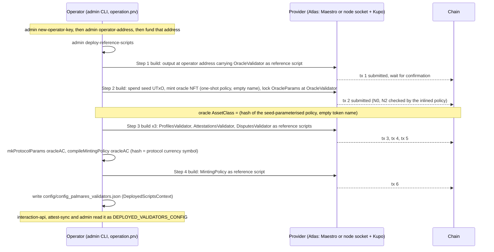

### 2.1 The steps, with the code that performs them

| Step | What happens | Code |
|---|---|---|
| 0 | Operator key and address. | `Main.hs:747-799` |
| 1 | Deploy the **OracleValidator** reference script. One output at the operator's address, value `mempty` (the balancer raises it to the ledger minimum for the script's size), inline unit datum, `gyTxOutRefS = Just script`. The returned `TxOutRef` is `(txId, 0)` — output 0 by contract §1.2. | `Transactions.hs:146-156, 168-170`; `Skeletons.hs:182-184` |
| 2 | **Mint the oracle NFT and create the oracle UTxO.** A seed UTxO is picked from the operator wallet (`someUTxOWithoutRefScript`), the one-shot `OracleNFTPolicy` is compiled against that seed and **inlined** (`GYMintScript`, never a reference script), the token name is empty, the redeemer is unit. The initial `OracleParams` are: admin = operator key hash, `opPaused = False`, `opFeeConfig = Nothing`, `opMinUTxOValue = 1_000_000`, `opDisputeDeposit = 5_000_000`. The oracle output carries the NFT plus 3.5 ADA at the OracleValidator address with an inline datum. | `Transactions.hs:197-245`; `Validators.hs:96-99`; `OracleNFTPolicy.hs:33-42` |
| 3 | Deploy the three state validators (**Profiles, Attestations, Disputes**) as reference scripts, same shape as step 1. These validators are unparameterised, so their hashes are constants of the build. | `Transactions.hs:176-180`; `Validators.hs:27-73` |
| 4 | `mkProtocolParams oracleAC` bakes the three validator hashes and the oracle `AssetClass` into `ProtocolParams`; `compileMintingPolicy` applies them to the policy. **The policy's hash is the protocol currency symbol**: every profile, attestation and dispute id is an asset class under it. Deployed as the fifth reference script. | `Validators.hs:115-122, 149-151`; `Transactions.hs:182-185` |
| 5 | The six hash/ref pairs plus the oracle asset class are written as `DeployedScriptsContext` JSON to `config/config_palmares_validators.json`. | `Context.hs:23-32`; `Constants.hs:8-9`; `Main.hs:543` |
| 6 | Services load it: `interaction-api` and `admin` for building, `attest-sync` for the minting-policy hash that becomes its Kupo query pattern `<policyHex>.*` and its projection authenticity gate. | `src/exe/interaction-api/Main.hs:59`; `src/exe/attest-sync/Main.hs:84-94, 137` |

The order is forced: the minting policy cannot be compiled before the oracle NFT exists (compile-time
parameter) nor deployed before the three state validators exist (their hashes are in `ProtocolParams`). The
emulator's `deployValidators` deploys the state validators first and the oracle second
(`src/test/TestRuns.hs:117-161`); both orders end in the same context.

### 2.2 What a redeploy means

Changing any validator changes its hash, hence `ProtocolParams`, hence the minting policy's hash, hence every
id: "every existing id becomes an id under a dead policy" (`Utils.hs:121-124`). `attest-sync` detects a changed
policy hash at boot and wipes its projection tables before re-syncing (`src/exe/attest-sync/Main.hs:97-110`).
Kupo runs with `--match '*'` so no pattern needs editing in lockstep (`compose.yaml:183-194`); the named footgun
is `KUPO_SINCE` — a UTxO created before Kupo's start point is invisible forever (`compose.yaml:196-200`).

### 2.3 Where the reference scripts live, and who can spend them (finding F7)

`deployReferenceScript` pays each reference-script output to the operator's own payment-key address
(`Transactions.hs:148,152`). Only the operator's key guards them: a wallet sweep or a `cardano-cli` spend from
the same key removes them, after which every build fails and `/ready` turns 503
(`src/exe/interaction-api/InteractionAppMonad.hs:136-154`). `Skeletons.hs:177-180` still carries
`addRefScriptSkeleton`, targeting Atlas's always-fail `limboValidatorV2` address (immutable scripts); it has no
caller. "Recoverable by the operator" versus "immutable" is a deployment decision this document records, not makes.

### 2.4 Admin CLI command map

| Command | Kind | Does |
|---|---|---|
| `new-operator-key`, `operator-address`, `sign-tx` | no provider | key management; `sign-tx` is the stdin→stdout signer (`Main.hs:807-822`) |
| `deploy-reference-scripts` | provider, key | §2.1 |
| `write-blueprint`, `write-metrics-doc`, `reconcile-koios`, `apply-indexes`, `apply-roles` | no provider | artefacts and SQL, not part of the protocol flow |
| `pause-protocol`, `unpause-protocol`, `set-fees`, `set-min-utxo-value`, `set-dispute-deposit`, `rotate-admin` | provider, key | `OracleUpdate` transactions, §3.9 |
| `query-oracle` | provider, read-only | prints `OracleParams` (`Main.hs:589-607`) |
| `update-profile`, `issue-attestation`, `accept-attestation`, `cleanup-dust` | provider, key | user/maintenance transactions built, signed and submitted with `operation.prv` (`Transactions.hs:127-137`) |

There is deliberately no `claim-profile`, `open-dispute`, `resolve-dispute` or `delete-profile` command (`docs/deployment/attest-flow-smoke.md`).

## 3. Transaction anatomy

Common machinery used below:

- `getOracleRefInputSkeleton` finds the oracle UTxO by its NFT at the OracleValidator address, throws
  `ProtocolPaused` if `opPaused`, returns `mustHaveRefInput oracleRef` (`Operations.hs:35-42`; `Lookups.hs:125-137`).
- `getFeeSkeleton` adds `mustHaveOutput fcFeeAddress (feeFor action)` when `opFeeConfig` is `Just`
  (`Operations.hs:50-61`); on chain `checkFee` runs right after `M0` on every mint (`MintingPolicy.hs:173-184`).
- `txIsValidForSafeEra tip` = `isInvalidBefore tip` + `isInvalidAfter (tip + 25920 slots)` (`Skeletons.hs:46-56`).
- State UTxOs are spent through the deployed reference script with inline datum and redeemer
  (`Skeletons.hs:75-85`); user tokens from the caller's `used_addresses` with the chosen witness (`Skeletons.hs:125-134`).
- The wallet's `reservedCollateral`, if sent, is the collateral; otherwise Atlas picks one (`Context.hs:91-94, 103`).

### 3.1 Oracle NFT mint (bootstrap step 2)

| Aspect | Value | Code |
|---|---|---|
| Builder | `mintOracleNFTAndLockDatum`, admin only | `Transactions.hs:197-245` |
| Inputs | seed UTxO (key witness) + funding | `Transactions.hs:207, 228` |
| Reference inputs | none | |
| Mint | exactly 1 × `(oneShotPolicy(seed), "")`, policy inlined, unit redeemer | `Transactions.hs:231-233`; `OracleNFTPolicy.hs:36-41` |
| Outputs | 0: OracleValidator, NFT + 3 500 000 lovelace, inline `OracleParams` (admin = operator, unpaused, no fees, minLv 1 ADA, deposit 5 ADA); then change | `Transactions.hs:217-236` |
| Signatures | operator key (seed owner) | `Transactions.hs:241` |
| Validity | none | |
| Trace codes | `N0` seed spent, `N2` exact mint, `N1` purpose | `OracleNFTPolicy.hs:38-42` |

### 3.2 Reference-script deployment (bootstrap steps 1, 3, 4)

| Aspect | Value | Code |
|---|---|---|
| Builder | `deployReferenceScript`, one transaction per script, five in total | `Transactions.hs:146-156` |
| Inputs | funding from the operator wallet | |
| Outputs | 0: operator's key address, inline unit datum, `gyTxOutRefS = Just script`, lovelace raised by the balancer; then change | `Skeletons.hs:182-184` |
| Signatures | operator key | `Transactions.hs:153` |
| Validity | none | |
| On chain | no script runs; a plain key spend | |

### 3.3 (a) MintProfile — claim a profile

**Purpose.** Create a profile: mint the CIP-68 reference token (locked with the datum) and user token (the
authority instrument, which goes to the claimant's wallet), optionally claiming a Cardano credential.
**Built by** `claimProfileTX` (`Operations.hs:263-330`) via `POST /claim-profile`
(`src/exe/interaction-api/RestAPI.hs:128-133`, `ServiceHandlers.hs:36-40`) or `POST /build-tx` with
`ClaimProfileAction`; no admin command.

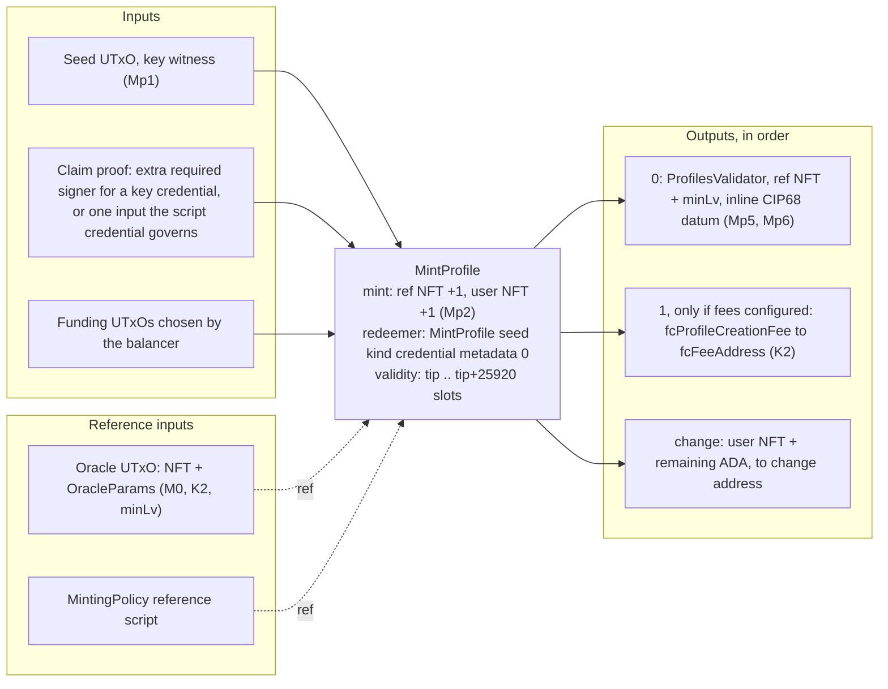

| Aspect | Value | Code |
|---|---|---|
| Inputs | seed = `someUTxOWithoutRefScript` from the wallet, key witness; claim proof (below); funding | `Operations.hs:284-288` |
| Reference inputs | oracle UTxO; minting-policy reference script | `Operations.hs:279-280, 301` |
| Mint | ref token and user token of the name derived from the seed, both +1, redeemer `MintProfile seed kind mCredential metadata 0` | `Operations.hs:298-301`; `Skeletons.hs:159-168` |
| Outputs | 0: profile state (`valueSingleton ref 1 <> lovelace minLv`, inline `CIP68Datum OnchainProfile` with `protocolParams` from the context); 1 (optional): fee; change carries the user token because it is paid nowhere explicitly | `Operations.hs:303-330, 255-258` |
| Signatures | owners of the seed/funding inputs; plus the claimed key hash when the credential is a key | `Operations.hs:236-238` |
| Validity | `[tip, tip + 25920 slots]`, attached though `MintProfile` carries no date | `Operations.hs:279, 323` |
| Trace codes | `M0`, `K2`, `K1` (oracle read), `Mp1`–`Mp6`, `M1`, `U0` | `MintingPolicy.hs:174-181, 285-321` |

**The three claim-witness variants** (`claimProofSkeleton`, `Operations.hs:231-247`;
`Conversions.hs:133-138`):

| Credential | `witness` in the request | What the skeleton adds | On-chain proof (`Mp3`) |
|---|---|---|---|
| key (`PubKeyCredential`) | ignored | `mustBeSignedBy pkh` | `pkh ∈ txInfoSignatories` (`Utils.hs:313`) |
| script, `{"tag":"simple_script","script":…}` | native script | `mustHaveInput` of the first reference-script-free UTxO at that script's payment credential, witnessed by the native script | an input whose **payment** credential is the script (`Utils.hs:314-318`) |
| script, `{"tag":"plutus_script","script":"<cbor>","redeemer":…}` | PlutusV3 script + redeemer | same input, witnessed by the inlined script with the given redeemer and no datum | same |
| none (`credential` omitted) | omitted | nothing | `checkClaim Nothing = True` (`MintingPolicy.hs:320`) |

A script credential with `witness` absent or `{"tag":"key"}` is refused as `ScriptCredentialHasNoUtxo`
(`Operations.hs:242-247`): the match only accepts the two script witnesses.

**Off-chain failures (HTTP):** `ProtocolPaused` 503; `CredentialMalformed` 400 (`Interactions.hs:108`,
`Operations.hs:240`); `ScriptCredentialHasNoUtxo` 400; `OracleNotFound` 404 / `OracleDatumInvalid` 500;
an empty wallet surfaces as Atlas `GYQueryUTxOException` → 400 `InsufficientFunds`
(`InteractionAppMonad.hs:88-109`).

### 3.4 (b) UpdateProfile

**Purpose.** Rewrite description and image; the name is immutable because the on-chain update never writes it
(`CIP68.hs:259-265`) and the builder keeps the old one (`Operations.hs:169-176`). **Built by** `updateProfileTX` (`Operations.hs:146-196`) via `POST /update-profile` or `admin update-profile`.

| Aspect | Value | Code |
|---|---|---|
| Inputs | profile **user** NFT from `used_addresses`, key witness; profile **state** UTxO at ProfilesValidator, reference-script witness, redeemer `UpdateProfile mergedFields 0`; funding | `Operations.hs:177-183` |
| Reference inputs | oracle UTxO — required on chain, read through the datum's own `protocolParams` (`P6`, `K1`) | `Operations.hs:159`; `ProfilesValidator.hs:111,129` |
| Mint | none | |
| Outputs | 0: same ProfilesValidator address, value ≥ spent (`geq`), datum = `updateCIP68DatumMetadata`; change | `Operations.hs:184-196` |
| Signatures | wallet keys for the user-NFT and funding inputs (no `mustBeSignedBy`) | |
| Validity | `[tip, tip + 25920 slots]`, not read by the validator | `Operations.hs:159, 193` |
| Trace codes | `P0`, `P1`, `P6`, `P2`, `P3`, `P4`, `P5`, `K1`, `U1` | `ProfilesValidator.hs:92-157` |
| Off-chain failures | `ProtocolPaused` 503; `ProfileNotFound` 404 (state UTxO: `Lookups.hs:90`; user token not held: `Skeletons.hs:128`); `DatumParseError` 500; `NFTNotFound` 404 | |

### 3.5 (c) NewAttestation — issue

**Purpose.** An issuer profile records a claim about a subject. Only the **reference** token is minted (no
user token), so the record has no transferable owner; the subject's consent comes later (§3.6).
**Built by** `issueAttestationTX` (`Operations.hs:365-479`) via `POST /issue-attestation` or
`admin issue-attestation` (which always sends empty `other_metadata`, `Main.hs:500-509`).

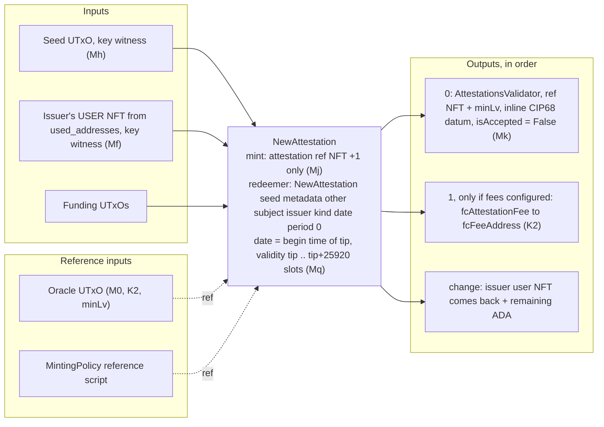

| Aspect | Value | Code |
|---|---|---|
| Pre-checks (before any skeleton) | reserved `other_metadata` keys; subject NFT exists (profile **or** attestation — lineage is allowed); claimed period not inverted | `Operations.hs:383-388, 397, 414-415`; `Lookups.hs:182-184` |
| Inputs | seed; issuer user NFT (derived from the issuer profile id, looked up at `used_addresses`); funding | `Operations.hs:418-422` |
| Reference inputs | oracle; minting policy | `Operations.hs:391, 446` |
| Mint | attestation ref token +1, redeemer `NewAttestation seed metadata other subject issuer kind attestationDate claimedPeriod 0` | `Operations.hs:431-446` |
| Outputs | 0: attestation state at AttestationsValidator, `ref NFT + minLv`, datum with `attestationIsAccepted = False`; 1 (optional): fee; change | `Operations.hs:449-479` |
| Signatures | wallet keys (no `mustBeSignedBy`) | |
| Validity | `[tip, tip + 25920 slots]`; `attestationDate = slotToBeginTime tip`, i.e. the interval's lower bound | `Operations.hs:406-407`; `TxBuilding/Utils.hs:117-118` |
| Trace codes | `M0`, `K2`, `K1`, `Mq`, `Mm`, `Mn`, `Mf`, `Mg`, `Mh`, `Mj`, `Mk` | `MintingPolicy.hs:243-252` |
| Off-chain failures | `AttestationOtherMetadataReservedKeys` 400; `SubjectProfileNotFound` 404; `AttestationPeriodInverted` 400; `ProfileNotFound` 404 (issuer token not held); `ProtocolPaused` 503 | |

Not checked on chain: that the subject exists (`Mg` is policy + prefix only) and anything about `claimedPeriod` (`MintingPolicy.hs:225-232`).

### 3.6 (d) AcceptAttestation — countersign

**Purpose.** The subject spends its own user NFT beside the attestation UTxO, re-locking it with
`isAccepted = True`. This is the protocol's single irreversible write.
**Built by** `acceptAttestationTX` (`Operations.hs:486-546`) via `POST /accept-attestation` or
`admin accept-attestation`.

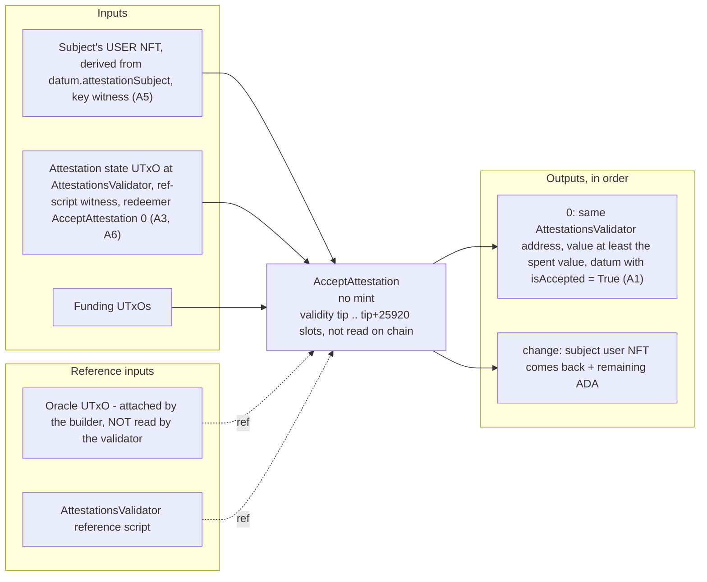

| Aspect | Value | Code |
|---|---|---|
| Inputs | subject user NFT (`deriveUserFromRefAC attestationSubject`) from `used_addresses`, key witness; attestation state UTxO via reference script with redeemer `AcceptAttestation 0`; funding | `Operations.hs:500-506, 526-529` |
| Reference inputs | oracle (off-chain pause gate only); AttestationsValidator reference script | `Operations.hs:497, 544` |
| Mint | none | |
| Outputs | 0: attestation re-locked, same value, `attestationIsAccepted = True`; change | `Operations.hs:516-517, 531-537` |
| Signatures | wallet keys | |
| Validity | `[tip, tip + 25920 slots]`, unused on chain | `Operations.hs:543` |
| Trace codes | `A0`, `A2`, `A3`, `A1`, `A5`, `A6`, `U1` | `AttestationsValidator.hs:97-146` |
| Off-chain failures | `AttestationAlreadyAccepted` 400 (`Operations.hs:514-515`); `AttestationNotFound` 404; `ProfileNotFound` 404 (the subject's user token is not in `used_addresses`); `ProtocolPaused` 503 | |

A **lineage** attestation (subject = another attestation id) can never pass: no user token was ever minted for
an attestation, so `A5` is unsatisfiable and the builder fails earlier with `ProfileNotFound`
(`AttestationsValidator.hs:14-28`; `Attestation` test 5.11b).

### 3.7 (e) OpenDispute

**Purpose.** A profile contests an attestation by locking a deposit in a new dispute UTxO that points at it.
The attestation is neither spent nor referenced (`MintingPolicy.hs:323-328`).
**Built by** `openDisputeTX` (`Operations.hs:572-673`) via `POST /open-dispute`; no admin command.

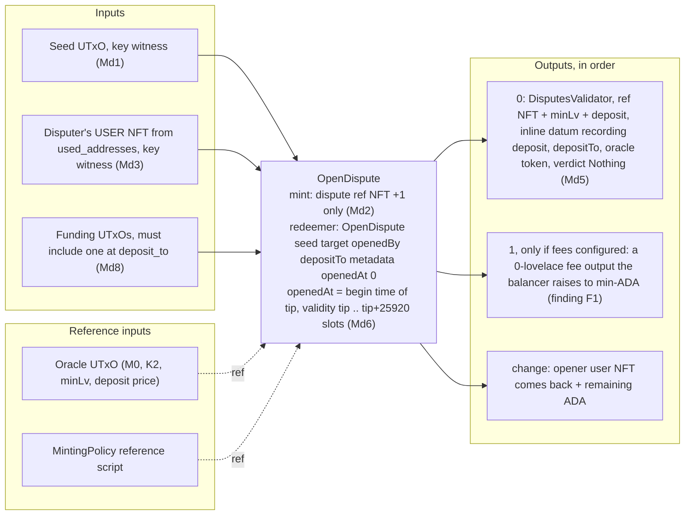

| Aspect | Value | Code |
|---|---|---|
| Pre-checks | target attestation exists (`AttestationNotFound`); no open dispute against it, by scanning the whole Disputes address (`DisputeAlreadyOpen`) | `Operations.hs:593-597`; `Lookups.hs:208-214` |
| Inputs | seed; opener user NFT; funding | `Operations.hs:611-615` |
| Reference inputs | oracle; minting policy | `Operations.hs:599, 637` |
| Mint | dispute ref token +1, redeemer `OpenDispute seed target openedBy depositTo metadata openedAt 0` | `Operations.hs:624-637` |
| Outputs | 0: dispute state, `ref NFT + minLv + deposit`, datum records `disputeDeposit = opDisputeDeposit` **at open time** and `disputeOracleToken`; then the fee skeleton; change | `Operations.hs:639-673` |
| `deposit_to` | request field, default = `change_address` | `Interactions.hs:128-138` |
| Signatures | wallet keys | |
| Validity | `[tip, tip + 25920 slots]`; `openedAt = slotToBeginTime tip` | `Operations.hs:607-608` |
| Trace codes | `M0`, `K2`, `K1`, `Md1`, `Md2`, `Md3`, `Md4`, `Md8`, `Md5`, `Md6`, `Md7` | `MintingPolicy.hs:400-409` |
| Off-chain failures | `AttestationNotFound` 404; `DisputeAlreadyOpen` 400; `ProfileNotFound` 404; `ProtocolPaused` 503 | |

**Finding F1 — the fee output.** `feeFor MintActionDispute = const 0` (`Lookup.hs:103`) and `checkFee` passes
without inspecting outputs when the fee is `≤ 0` (`Lookup.hs:121`). `getFeeSkeleton` (`Operations.hs:55-61`)
only distinguishes `Nothing`/`Just` and under `Just` calls `txMustPayValueToAddress gyFeeAddr (valueFromLovelace 0)`.
Atlas raises every declared output to the ledger minimum (the behaviour the validators' `geq` checks tolerate,
§1.2), so under a configured fee the dispute carries an unrequested ≈1 ADA output to `fcFeeAddress` that never
comes back; likewise for a profile or attestation whose own fee is `0` while the other is priced. No emulator
test mints under a configured fee (`UnitTests.Oracle` 0.3 sets and clears fees with no mint between;
`MutationGuards` 8.12–8.16 are validator-level). Fix: a zero short-circuit in `getFeeSkeleton` mirroring `Lookup.hs:121`.

**Finding F4 — `Md8` has no off-chain mirror.** `Md8` requires an input at `depositTo` (`MintingPolicy.hs:406`);
the builder never checks it. With one wallet address (smoke script, emulator) the seed comes from the change
address and `Md8` holds; with a multi-address wallet whose change address contributes no input, script
evaluation fails at build time and the route answers 400 `InsufficientFunds` (`InteractionAppMonad.hs:93`).
`Dispute` test 6.8 pins the on-chain half only.

### 3.8 (f) ResolveDispute

**Purpose.** The oracle admin writes a verdict once and the deposit goes back — on either verdict — to the
address recorded in the datum.
**Built by** `resolveDisputeTX` (`Operations.hs:708-761`) via `POST /resolve-dispute` only
(`RestAPI.hs:158-163`). The route returns an **unsigned** transaction; the admin signs it
(`admin sign-tx`) because `D1` wants `opAdminPkh` in `txInfoSignatories`. There is no admin command.

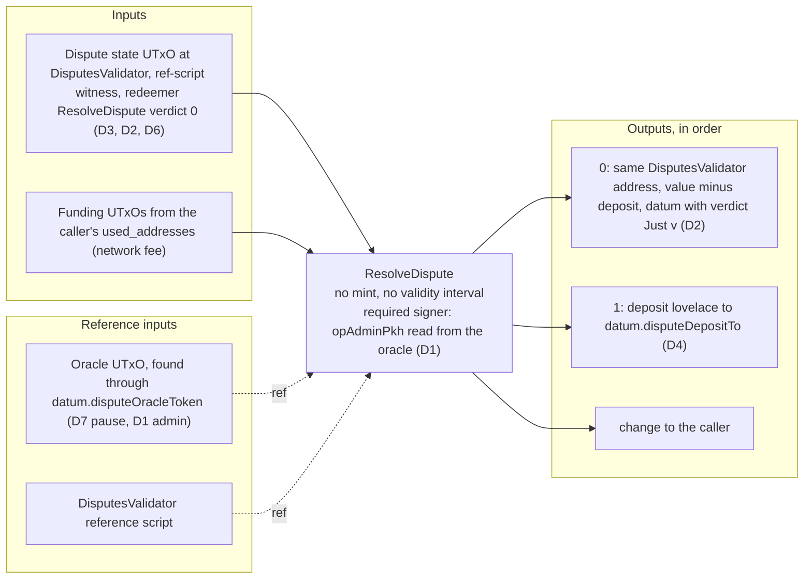

| Aspect | Value | Code |
|---|---|---|
| Pre-check | `disputeVerdict` must be `Nothing` (`DisputeAlreadyResolved`) | `Operations.hs:721-722` |
| Inputs | dispute state UTxO via reference script, redeemer `ResolveDispute verdict 0`; funding from the request's wallet | `Operations.hs:734-735` |
| Reference inputs | oracle, read with `queryOracleParams` (no pause check); DisputesValidator reference script | `Operations.hs:724, 757` |
| Mint | none | |
| Outputs | 0: resolved dispute, `value − deposit`, datum from `resolveDispute verdict` (the same function the validator uses); 1: `deposit` to `disputeDepositTo`; change | `Operations.hs:737-752` |
| Signatures | `mustBeSignedBy opAdminPkh`; plus the caller's wallet keys for funding inputs | `Operations.hs:725, 760` |
| Validity | **none** (no `isInvalidBefore`/`isInvalidAfter`) | |
| Trace codes | `D0`, `D5`, `D7`, `D3`, `D1`, `D2`, `D4`, `D6`, `K1`, `U1` | `DisputesValidator.hs:104-185` |
| Off-chain failures | `DisputeNotFound` 404; `DisputeAlreadyResolved` 400; `DatumParseError` 500; `OracleNotFound` 404; **not** `ProtocolPaused` (F3) | |

The deposit amount is the datum's `disputeDeposit`, never the oracle's current price
(`DisputesValidator.hs:114-119`; `Operations.hs:739`). `D6` allows one dispute per transaction; the builder builds one.

### 3.9 (g) OracleUpdate — the six admin actions

**Purpose.** Spend the oracle UTxO and re-lock it with `applyOracleAdminAction action params`. **Built by**
`updateOracleTX` (`Operations.hs:771-810`), admin CLI only: `AdminActionType`'s `FromJSON` always fails, so no HTTP route can carry one (`Actions.hs:394-399`).

| Aspect | Value | Code |
|---|---|---|
| Inputs | the oracle UTxO (datum already known from the query), reference-script witness, redeemer `OracleUpdate 0 action`; funding from the admin wallet | `Operations.hs:777-789` |
| Reference inputs | none | |
| Mint | none | |
| Outputs | 0: OracleValidator address, same value (balancer may add), inline datum `newParams`; change | `Operations.hs:792` |
| Signatures | `mustBeSignedBy opAdminPkh` (current admin); for `RotateAdminAction` also `mustBeSignedBy newAdmin` | `Operations.hs:795, 806-808` |
| Validity | none | |
| Trace codes | `O0`, `O4`, `O3`, `O1`, `O2`, `O5`, `O6`, `U1` | `OracleValidator.hs:72-94` |
| Off-chain failures | `OracleNotFound` 404 / `OracleDatumInvalid` 500; a non-admin cannot even submit (required signer missing) | `Oracle` test 0.6 |

| `AdminActionType` (CLI) | `OracleAdminAction` | Datum delta | Extra on-chain guard |
|---|---|---|---|
| `PauseProtocolAction` (`pause-protocol`) | `OraclePause` (0) | `opPaused = True` | — |
| `UnpauseProtocolAction` (`unpause-protocol`) | `OracleUnpause` (1) | `opPaused = False` | — |
| `SetFeesAction (Maybe FeeConfig)` (`set-fees --clear-fees` or `--fee-address --profile-fee --attestation-fee`) | `OracleSetFees` (2) | `opFeeConfig` | — |
| `SetMinUTxOValueAction n` (`set-min-utxo-value -n`) | `OracleSetMinUTxOValue` (3) | `opMinUTxOValue` | `O6`: must be ≥ 0 |
| `RotateAdminAction pkh` (`rotate-admin --new-admin`) | `OracleSetAdmin` (4) | `opAdminPkh` | `O5`: incoming key must also sign |
| `SetDisputeDepositAction n` (`set-dispute-deposit -n`) | `OracleSetDisputeDeposit` (5) | `opDisputeDeposit` (new disputes only) | `O6`: must be ≥ 0 |

`adminActionToOracleAdminAction` and `applyAdminAction` (`Operations.hs:813-829`) mirror
`applyOracleAdminAction` (`Types.hs:140-147`); `O2` compares the whole output datum, so they cannot drift silently.

**Finding F2 — `rotate-admin` cannot complete a real handover.** The CLI runs `runActionWithPK`, which builds,
signs with `[skey]` — the one key in `operation.prv` — and submits (`Transactions.hs:127-137`; `Main.hs:583-587`).
The body lists `newAdmin` as a required signer (`Operations.hs:806-808`), so for any key but the operator's own
the node rejects the transaction for a missing vkey witness before any script runs. The emulator needs
`adminRotateInteraction`, whose comment says exactly this about the single-key runner (`TestRuns.hs:1064-1100`;
`Oracle` tests 0.9, 0.11b), and the CLI has no build-only admin path to feed `admin sign-tx` from a second
checkout. Until it grows a second-witness step, rotation is an emulator-only flow.

**Dynamic consequence of every oracle update.** The oracle UTxO is a reference input of every user transaction;
an update spends it, so every user transaction built against the previous oracle `TxOutRef` and not yet
included fails phase-1 validation (reference input gone): rejected by the node, no collateral lost, rebuild
required. Expect in-flight user transactions to bounce around each update.

### 3.10 (h) Cleanup — dust sweep

**Purpose.** Anyone reclaims ADA parked at the three state validator addresses without touching protocol state.
**Built by** `cleanupDustTX` (`Operations.hs:856-870`) via `POST /build-tx` with `ProtocolAction CleanupDustAction`
(no dedicated service route; `Interactions.hs:142-145`) or `admin cleanup-dust` (`Main.hs:487-492, 631-635`).

| Aspect | Value | Code |
|---|---|---|
| Discovery | for each of Profiles, Attestations, Disputes: every UTxO at the address whose value holds **no** token under the protocol policy | `Lookups.hs:148-156`; `Operations.hs:838-850` |
| Inputs | every such UTxO, spent through that validator's reference script with that validator's own `Cleanup` redeemer, inline datum passed if present (`Nothing` otherwise); funding/collateral from the caller | `Skeletons.hs:100-107`; `Operations.hs:860-866` |
| Reference inputs | the three validator reference scripts; **no oracle** | |
| Mint | none | |
| Outputs | **none declared** — the recovered ADA lands in the caller's change output | `Operations.hs:855` |
| Signatures | caller's wallet keys | |
| Validity | none | |
| Trace codes | `P7` / `A4` / `D8` ("backed state, may not sweep"), `P1` / `A2` / `D5` purpose | `ProfilesValidator.hs:82-91`; `AttestationsValidator.hs:91-96`; `DisputesValidator.hs:95-103` |
| Off-chain failures | `NoDustFound` 404 | `Operations.hs:868-869` |

Not pausable, by design (`ProfilesValidator.hs:125-128`; `Pause` test 7.3). The OracleValidator has no
`Cleanup` arm: a datum-less UTxO parked at the oracle address hits `O3` and stays forever
(`OracleValidator.hs:72, 94`). **Finding F5:** on chain, a UTxO holding a protocol token other than the NFT its
datum names is sweepable (`Utils.hs:361-367`), but `getDustUTxOs` excludes any UTxO with any protocol-policy
token, so it is never offered. The comment at `TestRuns.hs:438-444` ("the validator must refuse, because its
datum parses") predates `isUnbackedDatum`; `Cleanup` test 3.5 asserts the opposite and is right.

## 4. Lifecycles

Transitions are redeemers, parenthesised codes are guards. No entity has a terminal state: nothing burns or deletes, and `Cleanup` refuses any UTxO that backs its own datum.

### 4.1 Profile

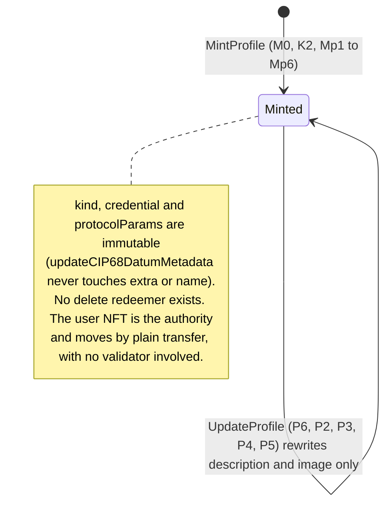

The user token is minted once (`Mp2`), must not sit beside the state (`Mp6`), and is all that `P3`, `Mf`, `A5`
and `Md3` ask for: its holder *is* the profile for every write, never bound to the claimed credential's holder
(`MintingPolicy.hs:308-314`).

### 4.2 Attestation

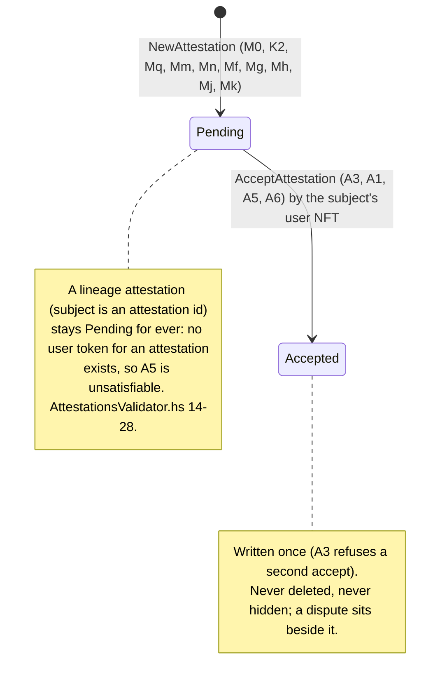

### 4.3 Dispute

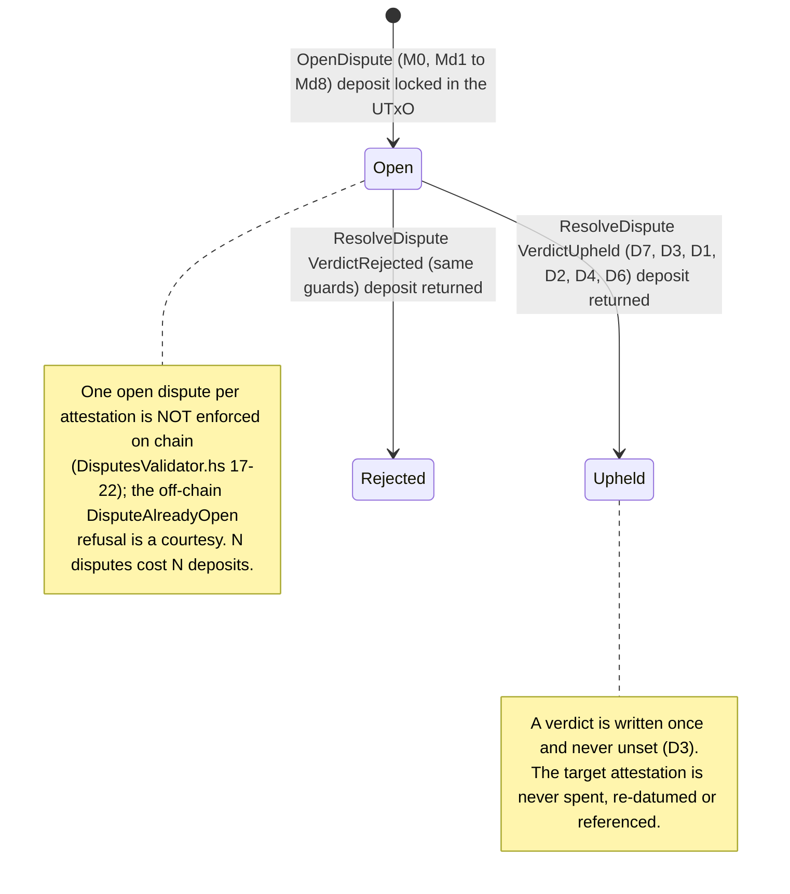

### 4.4 Oracle

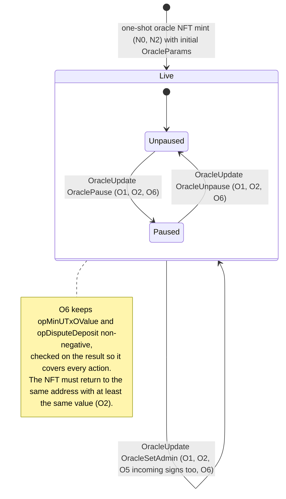

## 5. End-to-end journeys

Asynchronous boundaries are marked. `attest-sync` feeds the read surface by polling Kupo, so a projection appears
some time after confirmation and clients poll for it; neither service reports `attest-sync`'s lag
(`docs/deployment/attest-flow-smoke.md`). Bodies carry `user_addresses = {usedAddresses, changeAddress,
reservedCollateral?}` (camelCase inside, snake_case around: `scripts/smoke_attest_flow.sh:191-196`) and
addresses as **raw CBOR hex**, not bech32.

### 5.1 A DRep claims a profile and an organisation attests it

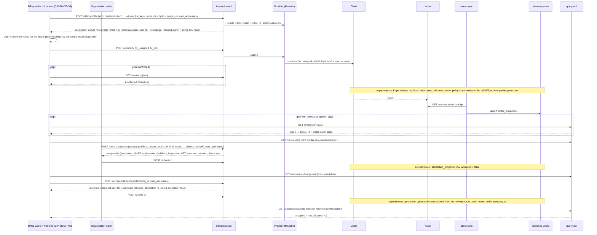

`scripts/smoke_attest_flow.sh:238-362` drives exactly this sequence with `admin sign-tx` as the wallet signer.
For a key-credential claim the wallet also signs with the DRep (or committee) key, which CIP-95 exposes beside
the payment keys; a script credential is proven by spending (§3.3) and needs no extra signature.

### 5.2 A dispute from open to verdict

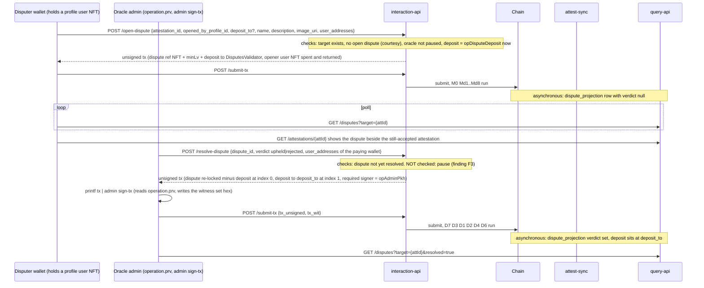

If the protocol is paused, the route still builds, `D7` trips during script evaluation and the route answers `400 InsufficientFunds` (§8): unpause first.

### 5.3 Operator pauses, reprices the deposit, rotates the admin

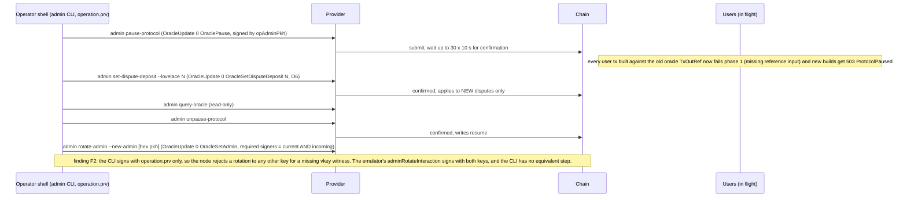

Each admin command builds, signs and submits in one step and blocks until confirmed (`Transactions.hs:72-80,
127-137`). While paused, `/status` reports `oracle_paused: true` (`ServiceStatus.hs:53-67, 93`) and every
mint/update route answers 503.

## 6. Economic model

| Transaction | Network fee paid by | Protocol fee (`feeFor`, only if `opFeeConfig` is `Just`) | Locked in the new/continuing state UTxO | Returned later | Collateral |
|---|---|---|---|---|---|
| Oracle NFT mint | operator | — | NFT + 3.5 ADA (`Transactions.hs:236`) | never | operator |
| Reference script (×5) | operator | — | min-ADA per script output, at the operator's key address | only if the operator spends them (which breaks the protocol) | operator |
| MintProfile | claimant | `fcProfileCreationFee` | ref NFT + `minLv` (+ balancer bump) | never | claimant |
| UpdateProfile | holder | — | unchanged (≥ spent) | — | holder |
| NewAttestation | issuer | `fcAttestationFee` | ref NFT + `minLv` | never | issuer |
| AcceptAttestation | subject | — | unchanged (≥ spent) | — | subject |
| OpenDispute | disputer | `0` by design (`Lookup.hs:94-98, 103`); see F1 for what the builder adds anyway | ref NFT + `minLv` + `deposit` | the `deposit` at resolution, to `disputeDepositTo` | disputer |
| ResolveDispute | the wallet in the request body (the admin signs; it need not fund) | — | ref NFT + `minLv` stays | — | that wallet |
| OracleUpdate | admin | — | unchanged (≥ spent) | — | admin |
| Cleanup | caller | — | — (dust ADA flows to the caller's change) | — | caller |

Fees go to `fcFeeAddress` as an ordinary output and are not recoverable. `minLv` is read from the oracle at
build time (`Operations.hs:281, 392, 601`), so repricing `opMinUTxOValue` changes the floor for new records only;
continuing outputs keep what they hold (`P5`, `A1`, `D2` compare against the spent value, not the oracle).

**Value locked for the life of the chain** (`Utils.hs:114-119`):

| Entity | Permanently locked | Why it cannot come back |
|---|---|---|
| Profile state | reference NFT + ≥ `opMinUTxOValue` at mint time | no burn redeemer; `Cleanup` refuses a backed datum (`P7`) |
| Attestation state | reference NFT + ≥ `opMinUTxOValue` | same (`A4`); accepted or pending alike |
| Dispute state (after resolution) | reference NFT + ≥ `opMinUTxOValue` | same (`D8`); only the deposit leaves (`D4`) |
| Dispute state (open) | the above + `disputeDeposit` | posted collateral, returned on either verdict |
| Oracle | NFT + 3.5 ADA | `O2` requires re-locking at least the same value at the same address |
| User tokens | nothing | they live in wallets; a lost user token is a profile nobody can act for |

Network fees scale with datum size; `otherMetadata` is capped at 16 entries of 64/256 bytes (`CIP68.hs:129-139`)
because the **subject** must re-lock the whole attestation to accept it (`CIP68.hs:115-119`).

## 7. Time model

| Stored date | Builder sets it to | Chain check | Code |
|---|---|---|---|
| `attestationDate` | begin time of the tip slot read at build time | `Mq`: contained in the validity interval, interval finite and ≤ `maxDateWindow` | `Operations.hs:406-407`; `MintingPolicy.hs:243`; `Utils.hs:243-248` |
| `disputeOpenedAt` | same | `Md6`, same rule | `Operations.hs:607-608`; `MintingPolicy.hs:408` |
| `attestationPeriod` (`claimed_period`) | whatever the issuer sent | **none**, deliberately; only `from ≤ to` off chain | `Types.hs:337-357`; `Operations.hs:361-363, 414-415` |

**The validity window.** Every user-side builder attaches `[tip, tip + 25920 slots]` (`Skeletons.hs:46-56`); at
one second per slot (preprod, mainnet) the width is 25 920 000 ms = 7.2 h. `checkDateInRange` requires both
bounds finite, `hi − lo ≤ maxDateWindow = 51 840 000 ms` (14.4 h, exactly twice the honest width), and
`date ∈ range` (`Utils.hs:239-248`). The stored date is the interval's lower bound, so an honest record is dated
at or before its block by at most 7.2 h. `ResolveDispute`, `OracleUpdate`, `Cleanup` and the deployment
transactions carry no validity interval; no validator reads a date from them.

**Practical deviation.** A hand-built transaction may choose any finite interval of width ≤ 14.4 h containing
its inclusion slot, so a stored date can sit up to 14.4 h either side of block time and no validator can tell
(`Utils.hs:216-231`). The read layer can narrow that by comparing the date with the projected slot
(`Utils.hs:236-238`); projections store chain time from the slot, never wall clock
(`src/lib/offchain-lib/CLAUDE.md`, "Time"). A wallet that widens the validity interval past 14.4 h makes an
honest issuance fail `Mq`/`Md6`.

**Self-reported means self-reported.** `claimed_period` is shown beside `issued_at` as a claim, never sorted or
filtered as a fact; the only guarantee is the subject's counter-signature on the record (`Types.hs:344-356`).

## 8. Pause model

`opPaused` is a write lever: off chain `getOracleRefInputSkeleton` checks it (`Operations.hs:38-42`), on chain exactly three codes do.

| Action | Off-chain guard (`ProtocolPaused`, HTTP 503) | On-chain gate | Behaviour while paused |
|---|---|---|---|
| MintProfile | yes (`Operations.hs:279`) | `M0` | refused at build; a hand-built tx fails `M0` |
| NewAttestation | yes (`391`) | `M0` | same |
| OpenDispute | yes (`599`) | `M0` | same |
| UpdateProfile | yes (`159`) | `P6` | same (`Pause` test 7.1 reaches `P6` with the guard removed) |
| AcceptAttestation | yes (`497`) | **none** — the validator reads no oracle (F6) | refused at build; a hand-built acceptance **succeeds** |
| ResolveDispute | **no** (`724` calls `queryOracleParams` directly; comment `698-703`) (F3) | `D7` | the route builds; script evaluation during balancing fails on `D7`; `runWithTxErrorHandling` maps the resulting `GYBuildTxException` to **400 `InsufficientFunds`** with the message "Not enough ADA in your wallet…" (`InteractionAppMonad.hs:93, 100-109`) — wrong code, wrong text. `Pause` test 7.2 pins the on-chain refusal only. |
| Cleanup | no | none (deliberate, `ProfilesValidator.hs:125-128`) | runs (`Pause` test 7.3) |
| OracleUpdate | no | none (so the admin can unpause) | runs |

`/status.oracle_paused` goes through the same `getOracleRefInputSkeleton` and is `null` when the oracle cannot be read (`ServiceStatus.hs:63-65, 93`).

## 9. Failure catalogue

HTTP statuses from `txBuildingExceptionToHttpStatus` (`Exceptions.hs:132-147`); bodies are
`{"code": <constructor>, "message": …}` (`InteractionAppMonad.hs:70-72`). The last column names the on-chain
code that would refuse the same mistake in a hand-built transaction, or says that nothing would.

| Constructor | Raised by | HTTP | If bypassed, caught on chain by |
|---|---|---|---|
| `ProfileNotFound` | user token not in `used_addresses` (`Skeletons.hs:128`); profile state UTxO missing (`Lookups.hs:90`) | 404 | `Mf` / `P3` / `A5` / `Md3` — the token is not yours to spend |
| `WrongProfileType` | `getOrganizationInformation` (`Lookups.hs:114`), not on a tx path | 400 | — |
| `AttestationNotFound` | `getAttestationDatumAndValue` (`Lookups.hs:167`) on accept and on open-dispute target lookup | 404 | accept: ledger (missing input); open-dispute: **nothing** — `Md4` checks only policy and prefix, so a deposit can be locked against a non-existent target |
| `AttestationAlreadyAccepted` | `Operations.hs:514-515` | 400 | `A3` |
| `AttestationOtherMetadataReservedKeys` | `Operations.hs:383-388` | 400 | `Mn` (`CIP68.hs:182-184`) |
| `AttestationPeriodInverted` | `Operations.hs:414-415` | 400 | nothing, by design |
| `SubjectProfileNotFound` | `Lookups.hs:182-184` | 404 | nothing — a permanently pending, unremovable record |
| `CredentialMalformed` | `Conversions.hs:111` via `Interactions.hs:108`; `Operations.hs:240` | 400 | n/a (the redeemer carries a `Credential`; `Mp3` checks whatever is encoded) |
| `ScriptCredentialHasNoUtxo` | `Operations.hs:247` | 400 | `Mp3` |
| `DisputeNotFound` | `Lookups.hs:195` | 404 | ledger (missing input) |
| `DisputeAlreadyOpen` | `Operations.hs:596-597` | 400 | nothing — not a protocol rule |
| `DisputeAlreadyResolved` | `Operations.hs:721-722` | 400 | `D3` |
| `OracleNotFound` | `Lookups.hs:131, 137` | 404 | `K1` (no reference input carries the oracle token) |
| `OracleDatumInvalid` | `Lookups.hs:136` | 500 | `K1` on read, `O0` on spend |
| `ProtocolPaused` | `Operations.hs:40-41` | 503 | `M0` / `P6` / `D7`; nothing for accept |
| `DeployedScriptsNotReady` | `Operations.hs:136-138`, from the `/ready` probe only (`InteractionAppMonad.hs:141`) | 503 | ledger (reference script missing) |
| `InvalidAssetClass` | `Skeletons.hs:35`; `Lookups.hs:50`; `TxBuilding/Utils.hs:168` | 400 | `Mg` / `Md4` |
| `NFTNotFound` | `Lookups.hs:52` (state spend lookups, `Skeletons.hs:78, 111`) | 404 | ledger / `P2`, `A6`, `D2` |
| `MultipleUtxosFound` | `Lookups.hs:45, 69` | 400 | n/a |
| `DatumParseError` | `Lookups.hs:85`; `TxBuilding/Utils.hs:164` | 500 | `P0` / `A0` / `D0` |
| `NoDustFound` | `Operations.hs:868-869` | 404 | n/a |
| Atlas `GYQueryUTxOException`, `GYBuildTxException`, `GYNoSuitableCollateralException` | empty wallet, cannot balance, no collateral, **and any script-evaluation failure during balancing** | 400 `InsufficientFunds` | the script code that failed (hidden by the message) |
| any other exception | — | 500 `InternalError` | — |
| `AdminActionType` in a body | `Actions.hs:394-399` (`FromJSON` always fails) | 400 (body parse) | `O1` — the admin must sign anyway |

## 10. How to keep this document true

The flows above are pinned by the emulator runners in `src/test/TestRuns.hs`, which drive the **production**
`interactionToTxSkeleton` path, plus the "malicious" builders that reach on-chain codes the production path cannot:

| Runner / builder | Pins | Code |
|---|---|---|
| `deployValidators`, `mintTestOracleNFT` | §2 (order, initial params, one-shot mint) | `TestRuns.hs:117-220` |
| `profileInteraction` | §3.3–§3.6 through the real pipeline | `307-328` |
| `disputeInteraction` | §3.7, §3.8 | `336-356` |
| `protocolInteraction` | §3.10 | `359-378` |
| `adminInteraction`, `adminRotateInteraction` | §3.9 (the second one is the two-key rotation, F2) | `381-400`, `1075-1100` |
| `malicious*` | `N2`, `O1`, `Mp3`, `Mp2`, `Mq`, `Mf`, `A3`, `P6`, `P7/A4/D8`, `D1/D3`, `D6` | `222-1062` |

Test suites, by section of this document:

- §2, §3.9: `UnitTests.Oracle` 0.1–0.13 (deployment, every admin action, `O1`, `O2`, `O5`, `N2`);
  `UnitTests.OracleRules` (`applyOracleAdminAction`, indices); `UnitTests.DisputeRules` oracle-output rules.
- §3.3: `UnitTests.Profile` 1.1–1.10 (key, native-script and staking-half claims, `Mp2`, `Mp3`);
  `UnitTests.Claim` (`checkCredentialControl`); `UnitTests.WritePath` (CIP-129 parsing, script-with-no-UTxO).
- §3.5–§3.6: `UnitTests.Attestation` 5.1–5.14 (issue, accept, `A3`, `Mq`, `Mf`, lineage limit 5.11b, `Mn`);
  `UnitTests.MutationGuards` 8.2–8.4 (`A1`, `A5`, `A6`), 8.6–8.9 (seeds, `K1`); `UnitTests.MintInputs`.
- §3.7–§3.8: `UnitTests.Dispute` 6.1–6.10 (`D1`, `D3`, `Md8`, `Md4`, `D6`); `UnitTests.DisputeRules`
  (`D2`, `D4`, `Md2`, `Md3`, `Md6`); `UnitTests.Satisfaction`; `UnitTests.MutationGuards` 8.10–8.11.
- §3.10: `UnitTests.Cleanup` 3.1–3.7. §6: `UnitTests.Fees`; `UnitTests.MutationGuards` 8.12–8.16 (`K2`).
- §7: `UnitTests.OracleRules` `checkDateInRange` cases; `UnitTests.Attestation` 5.12; `UnitTests.DisputeRules` `Md6`.
- §8: `UnitTests.Pause` 7.1–7.3; `UnitTests.MutationGuards` 8.1; `UnitTests.Attestation` `pauseStopsEverything`.
- §5: `UnitTests.InteractionApi` (typed routes, admin refusal, `/status`); `UnitTests.SignTx`;
  `UnitTests.Projections`, `UnitTests.ChainSyncReplay` (projection authentication, rollback replay); live:
  `scripts/smoke_attest_flow.sh` (F1 check 11).

Gaps that would let this document drift unnoticed, as of this revision: no emulator mint under a configured
`FeeConfig` (F1); no test of `admin rotate-admin` as the CLI runs it (F2); no test of `resolveDisputeTX` while
paused through the HTTP error mapping (F3); no multi-address-wallet test for `Md8` (F4); and the stale comment
at `TestRuns.hs:438-444` (test 3.5 itself is correct).

Rules of thumb: a new `mustHaveOutput` before an indexed output moves every redeemer index after it; a new date
in a datum needs `checkDateInRange` on chain and a tip-derived value off chain; a new write redeemer needs a
pause gate on chain **and** `getOracleRefInputSkeleton` off chain; any new spend of the oracle UTxO invalidates
in-flight user transactions (§3.9).
