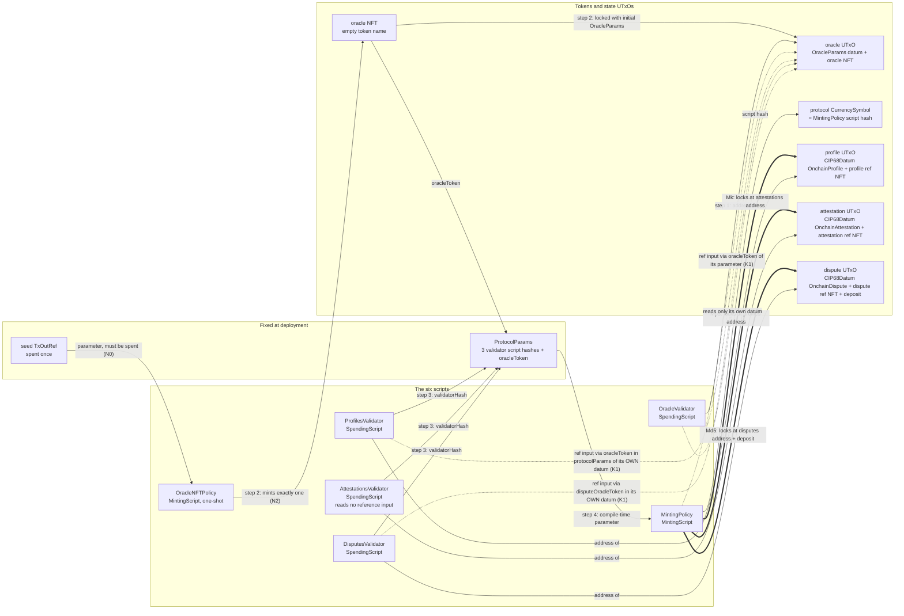
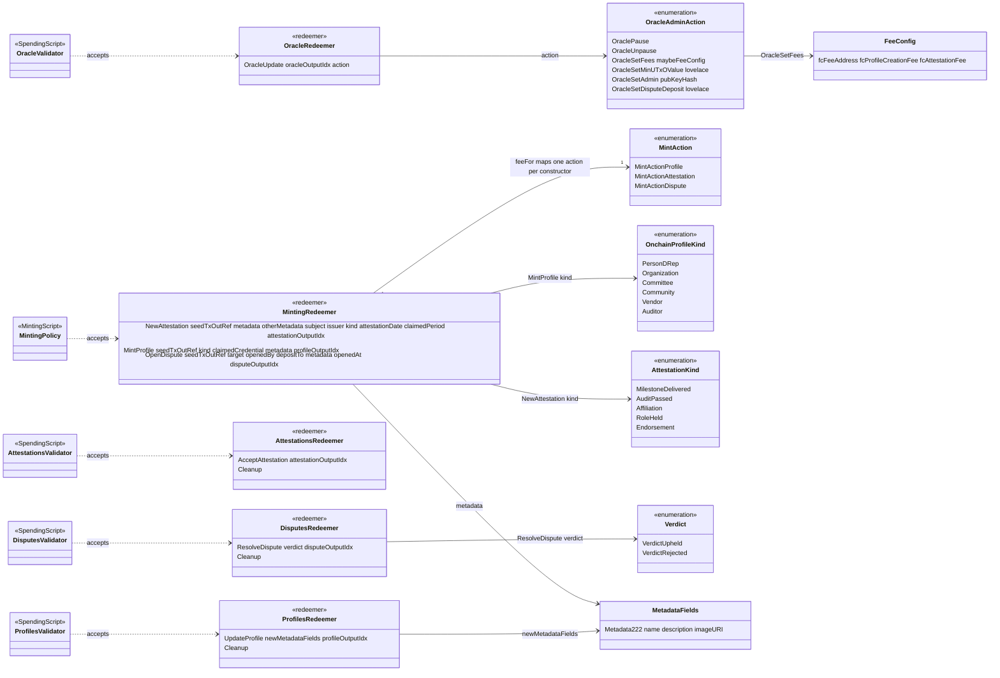

# Palmares on-chain protocol reference

The structural view of the Palmares attestation protocol as deployed on chain: the six scripts, what
each one is parameterised by, the state it locks (datums), the actions it accepts (redeemers), and the
tokens that tie the scripts together. Written against commit `4eb9117` on `main` (2026-10-22); every
rule below is cited to a source line and should be re-verified against the code when that commit moves.

## 1. Purpose and reading guide

| Document | What it answers |
|---|---|
| **This file** | What exists on chain and how the pieces relate — the static picture. Types, fields, constructor indices, trace codes, token derivations, authorisation, and the rules each validator does and does not enforce. |
| `onchain-flows.md` | How a transaction is assembled for each action and how a profile, attestation, dispute and the oracle move through their lifecycles. Not repeated here. |
| `docs/audit/` | Audit findings against the protocol. This document describes the code as it is; it does not grade it. |
| `docs/generated/` | The CIP-57 blueprint rendered by `admin write-blueprint` from `Palmares.Onchain.Blueprint` (`src/lib/onchain-lib/Palmares/Onchain/Blueprint.hs:3-4`). The machine-readable form of sections 4 and 5. |

Source map (all paths under `src/lib/onchain-lib/Palmares/Onchain/` unless stated):

| Module | Holds |
|---|---|
| `Protocol/Types.hs` | `ProtocolParams`, `FeeConfig`, `OracleParams`, `OracleAdminAction`, `MintAction`, `OnchainProfileKind`, `OnchainProfile`, `AttestationKind`, `OnchainAttestation`, `Verdict`, `OnchainDispute`, plus the pure state transitions `applyOracleAdminAction`, `resolveDispute`, `oracleParamsAreWellFormed`, `checkNoOpenDispute` |
| `Protocol/Lookup.hs` | `readOracleParams` (`K1`), `feeFor`, `checkFee` (`K2`), and the uncalled profile lookups (`K3`) |
| `Protocol/Id.hs` | `deriveSeededId`, `deriveIndexedId` — exported, **zero callers** in the repo (confirmed by grep; `CLAUDE.md:24-26` of the library says the same) |
| `CIP68.hs` | `CIP68Datum`, `MetadataFields`, metadata size limits, CIP-67 prefixes and ref/user derivations, `isProtocolRefToken` |
| `Utils.hs` | `mkUntypedLambda` (`U0`), `nameFromTxOutRef`, output-index checks, `isUnbackedDatum`, `checkCredentialControl`, `checkDateInRange`/`maxDateWindow`, `spentExactlyOnceFromAddress` |
| `Validators/*.hs` | One module per script (section 7) |
| `Blueprint.hs` | CIP-57 document; declares the minting policy by parameter and omits `OracleNFTPolicy` (`Blueprint.hs:384-386`) |
| `src/lib/offchain-lib/Palmares/TxBuilding/Validators.hs`, `Context.hs` | Compilation, hashes, `mkProtocolParams`, script sizes; `DeployedScriptsContext` — what is deployed as a reference script |

Conventions: trace codes are quoted as they appear in the source; "not enforced on chain" bullets
reproduce the reason the code itself gives; `path:line` cites the line a statement was read from.

## 2. The six scripts at a glance

| Script | Module | Purpose | Parameterised by | Datum it locks | Redeemer | Deployed as | Size (bytes) |
|---|---|---|---|---|---|---|---|
| MintingPolicy | `Validators/MintingPolicy.hs` | `MintingScript` (`MintingPolicy.hs:159`) | `ProtocolParams` = `{profilesValidatorScriptHash, attestationsValidatorScriptHash, disputesValidatorScriptHash, oracleToken}`, applied with `unsafeApplyCode`/`liftCode plcVersion110` (`MintingPolicy.hs:424-425`, `Types.hs:24-38`) | none (mints only) | `MintingRedeemer` | reference script, `mintingPolicyHashAndRef` (`Context.hs:24`), used via `GYMintReference` (`Skeletons.hs:152`) | 12276 |
| OracleNFTPolicy | `Validators/OracleNFTPolicy.hs` | `MintingScript` (`OracleNFTPolicy.hs:36`), one-shot | seed `TxOutRef` (`OracleNFTPolicy.hs:33,58-60`) | none | ignored — pattern `_` (`OracleNFTPolicy.hs:34`); off-chain passes `()` (`Transactions.hs:232`) | **inlined** in the oracle-mint tx via `GYMintScript` (`Transactions.hs:231`); not in `DeployedScriptsContext` | not pinned |
| ProfilesValidator | `Validators/ProfilesValidator.hs` | `SpendingScript` (`ProfilesValidator.hs:78`) | unparameterised | `ProfilesDatum = CIP68Datum OnchainProfile` (`ProfilesValidator.hs:65`) | `ProfilesRedeemer` | reference script, `profilesValidatorHashAndRef` (`Context.hs:25`), spent via `GYInReference` (`Skeletons.hs:84,94,106`) | 8414 |
| AttestationsValidator | `Validators/AttestationsValidator.hs` | `SpendingScript` (`AttestationsValidator.hs:85`) | unparameterised | `AttestationsDatum = CIP68Datum OnchainAttestation` (`AttestationsValidator.hs:76`) | `AttestationsRedeemer` | reference script, `attestationsValidatorHashAndRef` (`Context.hs:26`) | 7640 |
| DisputesValidator | `Validators/DisputesValidator.hs` | `SpendingScript` (`DisputesValidator.hs:86`) | unparameterised | `DisputesDatum = CIP68Datum OnchainDispute` (`DisputesValidator.hs:77`) | `DisputesRedeemer` | reference script, `disputesValidatorHashAndRef` (`Context.hs:27`) | 8457 |
| OracleValidator | `Validators/OracleValidator.hs` | `SpendingScript` (`OracleValidator.hs:72`) | unparameterised | `OracleParams` (bare, not CIP-68) | `OracleRedeemer` | reference script, `oracleValidatorHashAndRef` (`Context.hs:28`), spent via `txMustSpendFromRefScriptWithKnownDatum ovRef` (`Operations.hs:789`) | 7547 |

Size caveats, from `ScriptSize.hs` itself: the figures are the `expected` table at
`src/test/UnitTests/ScriptSize.hs:235-242`, flat-encoded bytes as deployed in the reference-script
output, measured with traces preserved — "the default build and therefore the one that gets deployed"
(`ScriptSize.hs:70-73`). The MintingPolicy is measured against a placeholder oracle token
(`ScriptSize.hs:50-52,68`); a real 28-byte currency symbol "adds a few bytes to this figure and
nothing structural". The suite also asserts every script is under 14,000 bytes so the deploying
transaction fits in `maxTxSize` (`ScriptSize.hs:39-47`). The table is updated in the same commit as
any change that moves a size, so the numbers above are only true of `4eb9117`.

Compiler settings: Plutus V3 (`PlutusLedgerApi.V3` throughout; `preamblePlutusVersion = PlutusV3`,
`Blueprint.hs:98`), plutus-core target 1.1.0 (`-fplugin-opt PlutusTx.Plugin:target-version=1.1.0`,
`palmares.cabal:67`), traces kept (`preserve-logging`, `palmares.cabal:94`; `optimize`, `:95`).

## 3. Diagram A — scripts, parameters and run-time reads



Legend: solid edges are deployment-time dependencies, thick edges are the outputs the minting policy
pins, dotted edges are run-time reads through reference inputs. The step numbers are the four steps of
`deployReferenceScripts` (`src/lib/offchain-lib/Palmares/TxBuilding/Transactions.hs:158-195`): (1)
deploy the OracleValidator reference script (`:170`); (2) mint the oracle NFT with the one-shot policy
and lock the initial `OracleParams` at the OracleValidator (`:174`, `mintOracleNFTAndLockDatum`
`:198-245`; the token name is empty, `OracleNFTPolicy.hs:37`); (3) deploy the Profiles, Attestations
and Disputes reference scripts (`:178-180`), whose hashes are deployment-independent because the
scripts are unparameterised; (4) build `ProtocolParams` from the three hashes and the oracle NFT asset
class (`mkProtocolParams`, `Validators.hs:115-122`), apply it to the minting policy and deploy that
(`:184-185`). The policy's hash is the protocol's currency symbol, so every protocol token id is
deployment-specific.

Where each script gets the oracle token from, which is the only external fact a validator needs:

| Script | Oracle token source | Line |
|---|---|---|
| MintingPolicy | `oracleToken protocolParams` — its compile-time parameter | `MintingPolicy.hs:160` |
| ProfilesValidator | `oracleToken (protocolParams profile)` — the `ProtocolParams` the minting policy pinned into the profile datum at `Mp5` | `ProfilesValidator.hs:111` |
| DisputesValidator | `disputeOracleToken dispute` — copied from the policy's parameter into the dispute datum at `Md5` (`MintingPolicy.hs:396`) | `DisputesValidator.hs:123` |
| AttestationsValidator | none — `OnchainAttestation` carries no oracle token, so no reference input is read and no pause gate exists on chain | `ScriptSize.hs:122-125` |
| OracleValidator | none — it *is* the oracle; reads only the datum being spent | `OracleValidator.hs:72-75` |

## 4. Diagram B — the entity-relationship view

The view is split in two because one diagram would exceed the readable node budget: **B1** is scripts,
datums and tokens; **B2** is redeemers and enumerations. Field names and types are copied from
`Protocol/Types.hs` and `CIP68.hs`. Mermaid cannot show a tuple inside a member line, so
`attestationPeriod :: Maybe (POSIXTime, POSIXTime)` is written `Maybe~PeriodPair~`.

### B1 — scripts, datums, tokens

```mermaid
classDiagram
  direction LR
  class MintingPolicy {
    <<MintingScript>>
    +ProtocolParams parameter
  }
  class OracleNFTPolicy {
    <<MintingScript>>
    +TxOutRef seedRef
  }
  class ProfilesValidator {
    <<SpendingScript>>
  }
  class AttestationsValidator {
    <<SpendingScript>>
  }
  class DisputesValidator {
    <<SpendingScript>>
  }
  class OracleValidator {
    <<SpendingScript>>
  }
  class CIP68Datum~plutusData~ {
    +Metadata metadata
    +Integer version
    +plutusData extra
  }
  class MetadataFields {
    +BuiltinByteString metadataName
    +BuiltinByteString metadataDescription
    +BuiltinByteString metadataImageURI
  }
  class ProfilesDatum {
    CIP68Datum OnchainProfile
  }
  class AttestationsDatum {
    CIP68Datum OnchainAttestation
  }
  class DisputesDatum {
    CIP68Datum OnchainDispute
  }
  class OnchainProfile {
    +ProfileId profileId
    +OnchainProfileKind profileKind
    +Maybe~Credential~ profileCredential
    +ProtocolParams protocolParams
  }
  class ProtocolParams {
    +ScriptHash profilesValidatorScriptHash
    +ScriptHash attestationsValidatorScriptHash
    +ScriptHash disputesValidatorScriptHash
    +AssetClass oracleToken
  }
  class OnchainAttestation {
    +AttestationId attestationId
    +ProfileId attestationIssuer
    +ProfileId attestationSubject
    +AttestationKind attestationKind
    +POSIXTime attestationDate
    +Maybe~PeriodPair~ attestationPeriod
    +Bool attestationIsAccepted
  }
  class OnchainDispute {
    +DisputeId disputeId
    +AttestationId disputeTarget
    +ProfileId disputeOpenedBy
    +POSIXTime disputeOpenedAt
    +Integer disputeDeposit
    +Address disputeDepositTo
    +AssetClass disputeOracleToken
    +Maybe~Verdict~ disputeVerdict
  }
  class OracleParams {
    +PubKeyHash opAdminPkh
    +Bool opPaused
    +Maybe~FeeConfig~ opFeeConfig
    +Integer opMinUTxOValue
    +Integer opDisputeDeposit
  }
  class FeeConfig {
    +Address fcFeeAddress
    +Integer fcProfileCreationFee
    +Integer fcAttestationFee
  }
  class ProfileRefNFT {
    <<token>>
    name 000643b0 ++ blake2b_224 of seed
  }
  class ProfileUserNFT {
    <<token>>
    name 000de140 ++ blake2b_224 of seed
  }
  class AttestationRefNFT {
    <<token>>
    name 000643b0 ++ blake2b_224 of seed
  }
  class DisputeRefNFT {
    <<token>>
    name 000643b0 ++ blake2b_224 of seed
  }
  class OracleNFT {
    <<token>>
    empty token name
  }
  MintingPolicy ..> ProtocolParams : parameterised by
  MintingPolicy ..> ProfileRefNFT : mints Mp2
  MintingPolicy ..> ProfileUserNFT : mints Mp2
  MintingPolicy ..> AttestationRefNFT : mints Mj
  MintingPolicy ..> DisputeRefNFT : mints Md2
  OracleNFTPolicy ..> OracleNFT : mints once N2
  ProfilesValidator "1" --> "*" ProfilesDatum : locks
  AttestationsValidator "1" --> "*" AttestationsDatum : locks
  DisputesValidator "1" --> "*" DisputesDatum : locks
  OracleValidator "1" --> "1" OracleParams : locks
  ProfilesDatum ..> CIP68Datum : instance of
  AttestationsDatum ..> CIP68Datum : instance of
  DisputesDatum ..> CIP68Datum : instance of
  ProfilesDatum --> OnchainProfile : extra
  AttestationsDatum --> OnchainAttestation : extra
  DisputesDatum --> OnchainDispute : extra
  CIP68Datum ..> MetadataFields : metadata keys name description image
  OnchainProfile --> ProtocolParams : protocolParams
  ProtocolParams --> ProfilesValidator : profilesValidatorScriptHash
  ProtocolParams --> AttestationsValidator : attestationsValidatorScriptHash
  ProtocolParams --> DisputesValidator : disputesValidatorScriptHash
  ProtocolParams --> OracleNFT : oracleToken
  OnchainProfile --> ProfileRefNFT : profileId
  ProfileUserNFT ..> ProfileRefNFT : deriveUserFromRefAC
  OnchainAttestation --> AttestationRefNFT : attestationId
  OnchainAttestation "*" --> "1" OnchainProfile : attestationIssuer
  OnchainAttestation "*" --> "1" OnchainProfile : attestationSubject
  OnchainDispute --> DisputeRefNFT : disputeId
  OnchainDispute "*" --> "1" OnchainAttestation : disputeTarget
  OnchainDispute "*" --> "1" OnchainProfile : disputeOpenedBy
  OnchainDispute --> OracleNFT : disputeOracleToken
  OracleParams --> FeeConfig : opFeeConfig
```



Notes on B1: `ProfileId`, `AttestationId` and `DisputeId` are all aliases of `AssetClass`
(`Types.hs:184-188`), so the arrows from `attestationIssuer`/`attestationSubject`/`disputeOpenedBy`
and `disputeTarget` are references by asset class that no validator dereferences — only their shape
is checked (`Mg`, `Md4`). `OnchainProfile.protocolParams` is the policy's own parameter, pinned by
`Mp5` (`MintingPolicy.hs:282,291`). No user token exists for an attestation or a dispute
(`MintingPolicy.hs:214,379` derive only the ref name); `ProfileUserNFT` is the sole authority
instrument. `OracleParams` is locked bare, not inside a `CIP68Datum` (`OracleValidator.hs:73`).

### B2 — redeemers and enumerations



Notes on B2: the three `MintingRedeemer` constructors map one-to-one onto `MintAction` through
`feeFor` (`Lookup.hs:100-103`, `MintingPolicy.hs:176-184`), which is exhaustive, so a new redeemer
without an action is a compile error (`Types.hs:218-219`). In `NewAttestation` the two `ProfileId`
arguments are **subject first, issuer second** (`MintingPolicy.hs:104,108,176`). `Cleanup` is a
constructor of three different redeemer types, always at index 1. No validator branches on
`OnchainProfileKind` or `AttestationKind` (`Types.hs:201,301-304`); they are stored for the read layer.
`OracleNFTPolicy` is absent from B2 because it ignores its redeemer (`OracleNFTPolicy.hs:34`).

## 5. Constructor index tables

Every index below is a deployed-data contract: constructors are appended, never reordered
(`src/lib/onchain-lib/CLAUDE.md:22-23`; `Types.hs:115-116`). Field order is the encoding order.

| Type | Constructor | Index | Fields, in order | Defined at |
|---|---|---|---|---|
| `ProtocolParams` | `ProtocolParams` | 0 | `profilesValidatorScriptHash :: ScriptHash`, `attestationsValidatorScriptHash :: ScriptHash`, `disputesValidatorScriptHash :: ScriptHash`, `oracleToken :: AssetClass` | `Types.hs:24-37` |
| `FeeConfig` | `FeeConfig` | 0 | `fcFeeAddress :: Address`, `fcProfileCreationFee :: Integer`, `fcAttestationFee :: Integer` | `Types.hs:48-59` |
| `OracleParams` | `OracleParams` | 0 | `opAdminPkh :: PubKeyHash`, `opPaused :: Bool`, `opFeeConfig :: Maybe FeeConfig`, `opMinUTxOValue :: Integer`, `opDisputeDeposit :: Integer` | `Types.hs:63-98` |
| `OracleAdminAction` | `OraclePause` | 0 | — | `Types.hs:102-136` |
| | `OracleUnpause` | 1 | — | |
| | `OracleSetFees` | 2 | `Maybe FeeConfig` | |
| | `OracleSetMinUTxOValue` | 3 | `Integer` | |
| | `OracleSetAdmin` | 4 | `PubKeyHash` | |
| | `OracleSetDisputeDeposit` | 5 | `Integer` | |
| `MintAction` | `MintActionProfile` | 0 | — | `Types.hs:220-236` |
| | `MintActionAttestation` | 1 | — | |
| | `MintActionDispute` | 2 | — | |
| `OnchainProfileKind` | `PersonDRep` | 0 | — | `Types.hs:238-259` |
| | `Organization` | 1 | — | |
| | `Committee` | 2 | — | |
| | `Community` | 3 | — | |
| | `Vendor` | 4 | — | |
| | `Auditor` | 5 | — | |
| `OnchainProfile` | `OnchainProfile` | 0 | `profileId :: ProfileId`, `profileKind :: OnchainProfileKind`, `profileCredential :: Maybe Credential`, `protocolParams :: ProtocolParams` | `Types.hs:261-282` |
| `AttestationKind` | `MilestoneDelivered` | 0 | — | `Types.hs:307-326` |
| | `AuditPassed` | 1 | — | |
| | `Affiliation` | 2 | — | |
| | `RoleHeld` | 3 | — | |
| | `Endorsement` | 4 | — | |
| `OnchainAttestation` | `OnchainAttestation` | 0 | `attestationId :: AttestationId`, `attestationIssuer :: ProfileId`, `attestationSubject :: ProfileId`, `attestationKind :: AttestationKind`, `attestationDate :: POSIXTime`, `attestationPeriod :: Maybe (POSIXTime, POSIXTime)`, `attestationIsAccepted :: Bool` | `Types.hs:328-363` |
| `Verdict` | `VerdictUpheld` | 0 | — | `Types.hs:379-385` |
| | `VerdictRejected` | 1 | — | |
| `OnchainDispute` | `OnchainDispute` | 0 | `disputeId :: DisputeId`, `disputeTarget :: AttestationId`, `disputeOpenedBy :: ProfileId`, `disputeOpenedAt :: POSIXTime`, `disputeDeposit :: Integer`, `disputeDepositTo :: Address`, `disputeOracleToken :: AssetClass`, `disputeVerdict :: Maybe Verdict` | `Types.hs:419-437` |
| `CIP68Datum a` | `CIP68Datum` | 0 | `metadata :: Metadata`, `version :: Integer`, `extra :: a` | `CIP68.hs:60-71` |
| `MetadataFields` | `Metadata222` | 0 | `metadataName`, `metadataDescription`, `metadataImageURI` (all `BuiltinByteString`) | `CIP68.hs:73-82` |
| `MintingRedeemer` | `NewAttestation` | 0 | `TxOutRef`, `MetadataFields`, `[(BuiltinByteString, BuiltinByteString)]`, `ProfileId` (subject), `ProfileId` (issuer), `AttestationKind`, `POSIXTime`, `Maybe (POSIXTime, POSIXTime)`, `Integer` (output index) | `MintingPolicy.hs:103-133` |
| | `MintProfile` | 1 | `TxOutRef`, `OnchainProfileKind`, `Maybe Credential`, `MetadataFields`, `Integer` (output index) | |
| | `OpenDispute` | 2 | `TxOutRef`, `AttestationId`, `ProfileId`, `Address`, `MetadataFields`, `POSIXTime`, `Integer` (output index) | |
| `ProfilesRedeemer` | `UpdateProfile` | 0 | `MetadataFields`, `Integer` (output index) | `ProfilesValidator.hs:52-63` |
| | `Cleanup` | 1 | — | |
| `AttestationsRedeemer` | `AcceptAttestation` | 0 | `Integer` (output index) | `AttestationsValidator.hs:67-74` |
| | `Cleanup` | 1 | — | |
| `DisputesRedeemer` | `ResolveDispute` | 0 | `Verdict`, `Integer` (output index) | `DisputesValidator.hs:68-75` |
| | `Cleanup` | 1 | — | |
| `OracleRedeemer` | `OracleUpdate` | 0 | `Integer` (output index), `OracleAdminAction` | `OracleValidator.hs:48-52` |

Library types inside these records (`Maybe`, pairs, `Credential`, `Address`, `AssetClass`, `Bool`) use
the encodings defined by `plutus-tx`/`plutus-ledger-api`, not by this repository; the rendered
blueprint is the place to read them.

### `CIP68Datum` layout

A profile, attestation or dispute datum is `CIP68Datum extra` with (`mkCIP68Datum`, `CIP68.hs:222-236`):

| Field | Content | Source |
|---|---|---|
| `metadata` | `AssocMap` built from `[("name", metadataName), ("description", metadataDescription), ("image", metadataImageURI)] <> otherMetadata` — UTF-8 keys | `CIP68.hs:226-233` |
| `version` | `metadataVersion = 1` | `CIP68.hs:54-56,234` |
| `extra` | the typed record (`OnchainProfile`, `OnchainAttestation` or `OnchainDispute`) | `CIP68.hs:235` |

`otherMetadata` is non-empty only for attestations: `MintProfile` and `OpenDispute` pass `[]`
(`MintingPolicy.hs:284,399`). Size limits enforced at mint (`Mm`/`Mp4`/`Md7` via
`validateMetadataFields`, `Mn` via `validateOtherMetadata`) and on update (`P4`):

| Limit | Value | Source |
|---|---|---|
| `maxNameLength` | 128 bytes | `CIP68.hs:87` |
| `maxDescriptionLength` | 1024 bytes | `CIP68.hs:91` |
| `maxImageURILength` | 256 bytes | `CIP68.hs:95` |
| `maxOtherMetadataEntries` | 16 | `CIP68.hs:131` |
| `maxOtherMetadataKeyLength` | 64 bytes | `CIP68.hs:135` |
| `maxOtherMetadataValueLength` | 256 bytes | `CIP68.hs:139` |
| other-metadata keys | no duplicates; none of `name`, `description`, `image` | `CIP68.hs:177-190` |

`UpdateProfile` replaces only `description` and `image` (`updateCIP68DatumMetadata`,
`CIP68.hs:260-265`); the `name` key is never rewritten, which is what makes the name immutable.

## 6. Token model

Derivations, all in `CIP68.hs` and `Utils.hs`:

- `nameFromTxOutRef (TxOutRef (TxId txIdbs) txIdx) = blake2b_224 (txIdbs <> integerToByteString BigEndian 0 txIdx)` — 28 bytes from the seed (`Utils.hs:68-70`).
- `refTokenPrefixBS = integerToByteString BigEndian 4 0x000643b0` and `userTokenPrefixBS = integerToByteString BigEndian 4 0x000de140` — the CIP-67 label bytes (`CIP68.hs:267-273`).
- `generateRefAndUserTN bs = (TokenName (refTokenPrefixBS <> bs), TokenName (userTokenPrefixBS <> bs))` — 32-byte names (`CIP68.hs:275-277`).
- `deriveUserFromRefAC (AssetClass (cs, tn)) = AssetClass (cs, deriveUserFromRefTN tn)`, where `deriveUserFromRefTN` replaces the first four bytes with the user prefix (`CIP68.hs:279-285`). This is how every validator turns an id into the token that must be spent (`Mf`, `Md3`, `P3`, `A5`).
- `isRefTokenName (TokenName bs) = sliceByteString 0 4 bs == refTokenPrefixBS`; `isProtocolRefToken (AssetClass (cs, tn)) cs' = cs == cs' && isRefTokenName tn` (`CIP68.hs:209-219`). Used by `Mg`, `Md4` and, prefix half only, by `isUnbackedDatum` (`Utils.hs:406-408`).
- The oracle NFT is `AssetClass (oracleNFTPolicyId, TokenName emptyByteString)` (`OracleNFTPolicy.hs:37`).

| Token | Policy | Token name | Minted by | Where it lives | What it does | Burned? |
|---|---|---|---|---|---|---|
| Profile ref NFT (= `ProfileId`) | MintingPolicy | `000643b0` ++ `blake2b_224(seed)` | `MintProfile`, `Mp2` | locked at ProfilesValidator inside the profile UTxO (`Mp5`) | identifies the profile; `P2` requires the spent input to hold it; `P7` refuses to sweep a datum it backs | never |
| Profile user NFT | MintingPolicy | `000de140` ++ same hash | `MintProfile`, `Mp2` | the holder's wallet — `Mp6` forbids it in the state output (`MintingPolicy.hs:315`) | the authority instrument: `UpdateProfile` (`P3`), issue as issuer (`Mf`), accept as subject (`A5`), open a dispute (`Md3`) | never |
| Attestation ref NFT (= `AttestationId`) | MintingPolicy | `000643b0` ++ `blake2b_224(seed)` | `NewAttestation`, `Mj` | locked at AttestationsValidator (`Mk`) | identifies the record; `A6` requires it in the spent input; no user token is ever minted for it | never |
| Dispute ref NFT (= `DisputeId`) | MintingPolicy | `000643b0` ++ `blake2b_224(seed)` | `OpenDispute`, `Md2` | locked at DisputesValidator together with the deposit (`Md5`) | identifies the dispute; `D2` requires it in the spent input; no user token | never |
| Oracle NFT | OracleNFTPolicy (seed-parameterised) | empty | one-shot, `N0`/`N2` | locked at OracleValidator with the `OracleParams` datum | authenticates the oracle UTxO: `readOracleParams` finds the reference input by `assetClassValueOf txOutValue oracleAC == 1` (`Lookup.hs:77-78`) | never |

Nothing burns. Every `MintingRedeemer` branch requires the burned value to be empty
(`mintValueBurned txInfoMint == mempty`, `MintingPolicy.hs:251,288,403`), the oracle policy does the
same (`OracleNFTPolicy.hs:41`), and no spending validator can drop its token: each continuing output
carries at least the spent value at the same address (`P5`, `A1`, `O2`) or the spent value less the
deposit (`D2`). The min-ADA under every record is therefore locked for good — "the price of a record
that cannot be retracted" (`Utils.hs:114-119`). Quantities are always exactly 1 because every mint
compares the whole minted value (section 9).

## 7. Per-script reference

Reading the tables: *Reads* names the parts of the `ScriptContext` a rule inspects; "valueSpent" is the
sum of all input values (`PlutusLedgerApi.V3.Contexts.valueSpent`); "outputs[idx]" is
`txInfoOutputs !! idx`, and an out-of-range index fails the script without a protocol code
(`Utils.hs:396-397`). `U0` (context does not parse, `Utils.hs:62`) precedes every table.

### 7.1 MintingPolicy

Datum: none. Redeemer: `MintingRedeemer`. Parameter: `ProtocolParams`. Runs for every mint or burn
under the protocol currency symbol; every branch is preceded by the oracle read and the pause gate.

| Code | Rule | Redeemer | Reads | Source |
|---|---|---|---|---|
| `M1` | Script purpose must be `MintingScript` | all | scriptInfo | `MintingPolicy.hs:185` |
| `K1` | Oracle UTxO must be a reference input holding `oracleToken protocolParams` with an inline `OracleParams` datum | all | reference inputs | `MintingPolicy.hs:160`, `Lookup.hs:67-78` |
| `M0` | `opPaused` must be `False` | all | oracle datum | `MintingPolicy.hs:174` |
| `K2` | If `opFeeConfig` is `Just` and `feeFor action > 0`, some output must pay ≥ that many lovelace to `fcFeeAddress`; zero fee or `Nothing` means no check | all | outputs, oracle datum | `MintingPolicy.hs:177,180,183`, `Lookup.hs:112-131` |
| `Mq` | `attestationDate` inside the validity interval, both bounds finite, width ≤ `maxDateWindow` | `NewAttestation` | validity range | `MintingPolicy.hs:243`, `Utils.hs:243-248` |
| `Mm` | `validateMetadataFields metadata` | `NewAttestation` | redeemer | `:244` |
| `Mn` | `validateOtherMetadata otherMetadata` — count, sizes, reserved keys, duplicates | `NewAttestation` | redeemer | `:245` |
| `Mf` | `valueSpent` holds exactly 1 of `deriveUserFromRefAC issuer` | `NewAttestation` | all inputs | `:246` |
| `Mg` | `subject` and `issuer` are both `isProtocolRefToken` under this policy's symbol | `NewAttestation` | redeemer, own symbol | `:247` |
| `Mh` | `seedTxOutRef` is among the inputs | `NewAttestation` | inputs | `:248` |
| `Mj` | Whole minted value == attestation ref NFT ×1, burned value empty | `NewAttestation` | mint | `:249-251` |
| `Mk` | outputs[attestationOutputIdx] at `scriptHashAddress attestationsValidatorScriptHash`, inline datum = computed attestation datum, value ≥ NFT + `opMinUTxOValue` | `NewAttestation` | outputs[idx] | `:252` |
| `Mp1` | seed spent | `MintProfile` | inputs | `:285` |
| `Mp2` | Whole minted value == profile ref NFT + profile user NFT, burned empty | `MintProfile` | mint | `:286-288` |
| `Mp3` | `checkClaim`: `Nothing` passes; `Just (PubKeyCredential pkh)` needs `pkh` in signatories; `Just (ScriptCredential _)` needs some input whose payment credential equals it | `MintProfile` | signatories, inputs | `:289,320-321`, `Utils.hs:311-318` |
| `Mp4` | `validateMetadataFields metadata` | `MintProfile` | redeemer | `:290` |
| `Mp5` | outputs[profileOutputIdx] at profiles address, datum = computed profile datum, value ≥ ref NFT + minLv | `MintProfile` | outputs[idx] | `:291` |
| `Mp6` | outputs[profileOutputIdx] holds 0 of the profile user NFT | `MintProfile` | outputs[idx] | `:315` |
| `Md1` | seed spent | `OpenDispute` | inputs | `:400` |
| `Md2` | Whole minted value == dispute ref NFT ×1, burned empty | `OpenDispute` | mint | `:401-403` |
| `Md3` | `valueSpent` holds exactly 1 of `deriveUserFromRefAC openedBy` | `OpenDispute` | all inputs | `:404` |
| `Md4` | `target` and `openedBy` are both `isProtocolRefToken` | `OpenDispute` | redeemer, own symbol | `:405` |
| `Md8` | Some input's address == `depositTo` | `OpenDispute` | inputs | `:406` |
| `Md5` | outputs[disputeOutputIdx] at disputes address, datum = computed dispute datum, value ≥ NFT + minLv + `opDisputeDeposit` lovelace | `OpenDispute` | outputs[idx], oracle datum | `:407` |
| `Md6` | `openedAt` inside the validity interval (same rule as `Mq`) | `OpenDispute` | validity range | `:408` |
| `Md7` | `validateMetadataFields metadata` | `OpenDispute` | redeemer | `:409` |

Output-index contract (the datum is recomputed on chain and compared byte-for-byte as inline datum,
`isGivenInlineDatum`, `Utils.hs:320-324`):

| Redeemer field | Output must contain |
|---|---|
| `NewAttestation … attestationOutputIdx` | `CIP68Datum` with metadata + otherMetadata, `version 1`, `extra = OnchainAttestation {attestationId = ref AC, attestationSubject = subject, attestationIssuer = issuer, attestationKind = kind, attestationDate, attestationPeriod = claimedPeriod, attestationIsAccepted = False}` (`MintingPolicy.hs:218-236`) |
| `MintProfile … profileOutputIdx` | `CIP68Datum` with metadata, `version 1`, `extra = OnchainProfile {profileId = ref AC, profileKind = kind, profileCredential = claimedCredential, protocolParams = <policy parameter>}` (`:277-284`); user NFT absent (`Mp6`) |
| `OpenDispute … disputeOutputIdx` | `CIP68Datum` with metadata, `version 1`, `extra = OnchainDispute {disputeId = ref AC, disputeTarget = target, disputeOpenedBy = openedBy, disputeOpenedAt = openedAt, disputeDeposit = opDisputeDeposit <from oracle>, disputeDepositTo = depositTo, disputeOracleToken = oracleToken <policy parameter>, disputeVerdict = Nothing}` (`:387-399`) |

Authorisation: `NewAttestation` — spend the issuer's user NFT (`Mf`) and the seed (`Mh`).
`MintProfile` — spend the seed (`Mp1`); if a credential is claimed, prove control of it (`Mp3`).
`OpenDispute` — spend the opener's user NFT (`Md3`), the seed (`Md1`), and something at `depositTo`
(`Md8`); lock the deposit (`Md5`). Credentials are tokens, not signature lists, by design
(`src/lib/onchain-lib/CLAUDE.md:46-50`).

Not enforced on chain (by design, reasons from the code):

- **Existence of subject, issuer, target, opener.** Only the asset-class shape is checked (`Mg`,
  `Md4`); the off-chain `ensureSubjectProfileExists` exists because "the minting policy checks only
  that the subject's asset class carries the protocol currency symbol … and nothing in this protocol
  burns" (`src/lib/offchain-lib/Palmares/TxBuilding/Lookups.hs:169-184`) — existence only, not kind.
- **The claimed period**: "deliberately NOT validated against the validity interval, and must never
  be … nothing on chain can confirm when a membership began" (`Types.hs:344-349`); an inverted period
  is a 400 off chain (`MintingPolicy.hs:225-232`).
- **One open dispute per attestation**: "cannot be enforced on chain without an index UTxO that every
  dispute would have to contend for … What bounds dispute spam is the deposit" (`Types.hs:449-458`).
- **The disputed attestation**: "not spent, not re-datumed, not even read as an input" (`:325-328`).
- **Where the user token goes**: `Mp6` keeps it out of the state output but cannot bind it to the
  claimed credential's holder, "which a validator cannot resolve for a script credential" (`:310-314`).
- **Kind**: no branch on `OnchainProfileKind` or `AttestationKind` (`Types.hs:301-304`). **Extra value**
  in state outputs: `Mk`/`Mp5`/`Md5` are `geq` checks that "positively permit extra tokens"
  (`Utils.hs:396-399`). **A dispute fee**: `feeFor MintActionDispute = const 0` (`Lookup.hs:94-98`).

### 7.2 OracleNFTPolicy

Datum: none. Redeemer: ignored. Parameter: seed `TxOutRef`.

| Code | Rule | Reads | Source |
|---|---|---|---|
| `N1` | Purpose must be `MintingScript` | scriptInfo | `OracleNFTPolicy.hs:42` |
| `N0` | Some input's `txInInfoOutRef == seedRef` | inputs | `:38` |
| `N2` | Whole minted value == 1 of `(ownSymbol, TokenName emptyByteString)`, burned empty | mint | `:37-41` |

No output check: where the NFT goes is the deploying transaction's business
(`Transactions.hs:236` locks it at the OracleValidator with 3,500,000 lovelace and the initial
`OracleParams`: unpaused, no fees, `opMinUTxOValue = 1000000`, `opDisputeDeposit = 5000000`,
`:217-225`). Not in the blueprint (`Blueprint.hs:384-386`).

### 7.3 ProfilesValidator

Datum: `CIP68Datum OnchainProfile`. Redeemers: `UpdateProfile MetadataFields Integer`, `Cleanup`.

| Code | Rule | Redeemer | Reads | Source |
|---|---|---|---|---|
| `P1` | Purpose must be `SpendingScript` | all | scriptInfo | `ProfilesValidator.hs:131` |
| `P7` | `Cleanup` on a datum that parses: `isUnbackedDatum (profileId profile)` must hold — the named token is not CIP-67 ref-prefixed, or the spent input holds 0 of it | `Cleanup` | own datum, own input value | `:82-91`, `Utils.hs:404-408` |
| `P0` | Datum absent or not a `CIP68Datum OnchainProfile` | `UpdateProfile` | own datum | `:92-95` |
| `U1` | Own input must be findable by `spendingTxOutRef` | `UpdateProfile` | inputs | `:97`, `Utils.hs:326-332` |
| `K1` | Oracle reference input found via `oracleToken (protocolParams profile)` | `UpdateProfile` | reference inputs, own datum | `:111` |
| `P6` | `opPaused` must be `False` | `UpdateProfile` | oracle datum | `:129` |
| `P2` | Own input value holds exactly 1 of `profileId` | `UpdateProfile` | own input value | `:153` |
| `P3` | `valueSpent` holds exactly 1 of `deriveUserFromRefAC profileId` | `UpdateProfile` | all inputs | `:154` |
| `P4` | `validateMetadataFields newFields` | `UpdateProfile` | redeemer | `:155` |
| `P5` | outputs[profileOutputIdx] at own address, datum = `updateCIP68DatumMetadata newFields profileDatum`, value ≥ own input value | `UpdateProfile` | outputs[idx] | `:156` |

`Cleanup` with no datum or an unparseable datum succeeds unconditionally (`:83-85`). `P2`–`P5` are
evaluated with `and [...]`, so a failing update logs every failing code, not only the first
(`ScriptSize.hs:198-204`).

Output-index contract: `UpdateProfile _ profileOutputIdx` → own address; same `version` and `extra`;
`metadata` with `description` and `image` replaced (`CIP68.hs:260-265`); value ≥ spent value.

Authorisation: spend the profile's user NFT (`P3`). `Cleanup` is permissionless.

Not enforced on chain (by design):

- **Deletion.** "Profile deletion is intentionally not supported to preserve lineage integrity"
  (`:49-50`).
- **Pause on `Cleanup`.** "deliberately NOT gated … making housekeeping pausable would let an admin
  freeze the dust sweep while the clutter accumulates" (`:125-128`).
- **`profileCredential` and `profileKind`** are never re-validated or changeable after mint; `P5` pins
  `extra` unchanged.

### 7.4 AttestationsValidator

Datum: `CIP68Datum OnchainAttestation`. Redeemers: `AcceptAttestation Integer`, `Cleanup`. Reads no
reference inputs, no validity range, no signatories and no mint field.

| Code | Rule | Redeemer | Reads | Source |
|---|---|---|---|---|
| `A2` | Purpose must be `SpendingScript` | all | scriptInfo | `AttestationsValidator.hs:146` |
| `A4` | `Cleanup` on a datum that parses: `isUnbackedDatum (attestationId (extra parkedDatum))` | `Cleanup` | own datum, own input value | `:91-96` |
| `A0` | Datum absent or not an `AttestationsDatum` | `AcceptAttestation` | own datum | `:98-100` |
| `U1` | Own input findable | `AcceptAttestation` | inputs | `:103` |
| `A3` | `attestationIsAccepted` must be `False` | `AcceptAttestation` | own datum | `:119` |
| `A1` | outputs[outputIdx] at own address, datum = same datum with `attestationIsAccepted = True`, value ≥ own value | `AcceptAttestation` | outputs[idx] | `:131-139` |
| `A5` | `valueSpent` holds exactly 1 of `deriveUserFromRefAC attestationSubject` | `AcceptAttestation` | all inputs | `:142` |
| `A6` | Own input value holds exactly 1 of `attestationId` | `AcceptAttestation` | own input value | `:145` |

Output-index contract: `AcceptAttestation outputIdx` → own address; `metadata` and `version`
unchanged; `extra` unchanged except `attestationIsAccepted = True` (`:106`); value ≥ spent value.

Authorisation: spend the **subject's** user NFT (`A5`). `Cleanup` is permissionless.

Not enforced on chain (by design):

- **Pause**: no oracle token in the datum, and "a token taken from the redeemer would be
  attacker-chosen and therefore worthless" (`ScriptSize.hs:122-125`); the off-chain builder refuses
  while paused (`Operations.hs:495-497`).
- **Lineage acceptance**: an attestation about an attestation "can never be accepted … No user token
  for an attestation exists" (`AttestationsValidator.hs:14-28`, pinned by `UnitTests.Attestation` 5.11b).
- **Issuer involvement, dates, the oracle**: none are read at acceptance. **Rejection**: there is no
  decline path; an unaccepted attestation stays pending.

### 7.5 DisputesValidator

Datum: `CIP68Datum OnchainDispute`. Redeemers: `ResolveDispute Verdict Integer`, `Cleanup`.

| Code | Rule | Redeemer | Reads | Source |
|---|---|---|---|---|
| `D5` | Purpose must be `SpendingScript` | all | scriptInfo | `DisputesValidator.hs:185` |
| `D8` | `Cleanup` on a datum that parses: `isUnbackedDatum (disputeId (extra parkedDatum))` — `disputeId`, never `disputeTarget` | `Cleanup` | own datum, own input value | `:95-103` |
| `D0` | Datum absent or not a `DisputesDatum` | `ResolveDispute` | own datum | `:105-107` |
| `U1` | Own input findable | `ResolveDispute` | inputs | `:110` |
| `K1` | Oracle reference input found via `disputeOracleToken dispute` | `ResolveDispute` | reference inputs, own datum | `:123` |
| `D7` | `opPaused` must be `False` | `ResolveDispute` | oracle datum | `:146` |
| `D3` | `disputeVerdict dispute == Nothing` | `ResolveDispute` | own datum | `:152` |
| `D1` | `opAdminPkh oracle` is a signatory | `ResolveDispute` | signatories, oracle datum | `:153` |
| `D2` | outputs[outputIdx] at own address, datum = `resolveDispute verdict`, value ≥ own value − `disputeDeposit` lovelace; **and** own input holds exactly 1 of `disputeId` | `ResolveDispute` | outputs[idx], own input value | `:154-167` |
| `D4` | Some output pays ≥ `disputeDeposit` lovelace to `disputeDepositTo` | `ResolveDispute` | outputs (any) | `:183` |
| `D6` | Exactly one input is spent from the validator's own address | `ResolveDispute` | inputs | `:184`, `Utils.hs:165-175` |

Output-index contract: `ResolveDispute verdict outputIdx` → own address; `extra` unchanged except
`disputeVerdict = Just verdict` (`Types.hs:446-447`); value ≥ spent value minus the deposit recorded
**in the datum** (`:114-119`). The deposit payout is found by `any` over all outputs, which `D6` makes
sound (`:175-182`).

Authorisation: the oracle admin's signature (`D1`), read from the oracle the dispute's own datum names.
`Cleanup` is permissionless.

Not enforced on chain (by design):

- **One open dispute per attestation**: "it would need an index UTxO that every dispute had to contend
  for … N disputes cost N deposits" (`:17-22`); `checkNoOpenDispute` (`Types.hs:462-466`) is an
  off-chain courtesy that "has no trace code here because there is no check".
- **`D6` is not a cap on disputes**: "Opening is unbounded; resolving is serialised" (`:24-26`).
- **The target attestation** is never read or modified; "the attestation is never hidden or deleted"
  is a read-layer property (`:8-15`, `Types.hs:371-378`). **No punitive verdict**: the deposit returns
  on either outcome (`:168-173`). **No time check** at resolution: the validity range is not read.

### 7.6 OracleValidator

Datum: `OracleParams`. Redeemer: `OracleUpdate Integer OracleAdminAction`. Reads no reference inputs.

| Code | Rule | Reads | Source |
|---|---|---|---|
| `O3` | Purpose must be `SpendingScript` **with** a datum attached (`SpendingScript spendingRef (Just (Datum bdatum))`); anything else, including a datum-less spend | scriptInfo | `OracleValidator.hs:72,94` |
| `O0` | Datum must decode as `OracleParams` | own datum | `:73-74` |
| `O4` | Redeemer must decode as `OracleRedeemer` (decoded with `fromBuiltinData`, so a malformed redeemer gets this code) | redeemer | `:76-77` |
| `U1` | Own input findable | inputs | `:79` |
| `O1` | `opAdminPkh currentParams` is a signatory | signatories | `:84` |
| `O2` | outputs[oracleOutputIdx] at own address, datum = `applyOracleAdminAction action currentParams`, value ≥ own value | outputs[idx] | `:85` |
| `O5` | For `OracleSetAdmin newAdmin`, `newAdmin` is also a signatory; other actions pass | signatories | `:86,111-112` |
| `O6` | `oracleParamsAreWellFormed newParams`: `opMinUTxOValue >= 0 && opDisputeDeposit >= 0` | computed datum | `:92`, `Types.hs:174-176` |

`applyOracleAdminAction` (`Types.hs:141-147`): `OraclePause` → `opPaused = True`; `OracleUnpause` →
`opPaused = False`; `OracleSetFees m` → `opFeeConfig = m`; `OracleSetMinUTxOValue n` →
`opMinUTxOValue = n`; `OracleSetAdmin pkh` → `opAdminPkh = pkh`; `OracleSetDisputeDeposit n` →
`opDisputeDeposit = n`. The expected datum is computed on chain and compared whole, so every field an
action does not name is provably untouched.

Output-index contract: `OracleUpdate oracleOutputIdx _` → own address; bare `OracleParams` inline
datum equal to the computed one; value ≥ spent value, which is what keeps the oracle NFT locked
(`:10-12`).

Authorisation: current admin's signature (`O1`); for a handover, the incoming admin's too (`O5`).

Not enforced on chain (by design):

- **Pause**: the oracle path "bypasses the pause on purpose, so the admin who paused can unpause"
  (`DisputesValidator.hs:131-135`). **No `Cleanup`**: `OracleRedeemer` has one constructor, so dust at
  the oracle address has no sweep path.
- **Fee amounts and the fee address** are not validated; `O6` checks only the two lovelace parameters,
  because a negative one makes every `geq` check in the protocol vacuous (`Types.hs:149-172`).

### 7.7 Shared helper codes

| Code | Where | Reachable from | Meaning |
|---|---|---|---|
| `U0` | `Utils.hs:62` (`parseData c "U0"`) | all six scripts | `ScriptContext` does not parse |
| `U1` | `Utils.hs:332` | every spending path that resolves its own input, and `isUnbackedDatum` on `Cleanup` | own input not found by `TxOutRef` |
| `U2` | `Utils.hs:421` | **unreachable** — only `checkAndGetCurrentStateDatumAndValue`, called only by `unsafeGetProfile`/`unsafeGetProfileDatumAndValue`, which no validator calls | state NFT not found at expected address |
| `U3` | `Utils.hs:427` | **unreachable** (same chain) | non-inline datum |
| `K1` | `Lookup.hs:73-75` | MintingPolicy, ProfilesValidator (`UpdateProfile`), DisputesValidator (`ResolveDispute`) | oracle reference input missing, non-inline, or undecodable |
| `K2` | `Lookup.hs:126` | MintingPolicy, all three redeemers | fee output missing |
| `K3` | `Lookup.hs:51-52` | **unreachable** — `unsafeGetProtocolParamsFromProfileRefInput` has no callers | profile reference input missing or non-inline |

Inventory at `4eb9117`, 65 distinct codes, all described above: `K1`–`K3`, `U0`–`U3`, `M0`, `M1`,
`Mq`, `Mm`, `Mn`, `Mf`, `Mg`, `Mh`, `Mj`, `Mk`, `Mp1`–`Mp6`, `Md1`–`Md8`, `P0`–`P7`, `A0`–`A6`,
`D0`–`D8`, `O0`–`O6`, `N0`–`N2`. `U0`, `U2`, `U3` live outside the validator modules and are the easy ones to miss.

## 8. Authorisation matrix

| Action | Script / redeemer | Proof the chain demands | Typically performed by | Pause-gated |
|---|---|---|---|---|
| Mint the oracle NFT | OracleNFTPolicy | spend the seed `TxOutRef` (`N0`) | the deployer, once | n/a — no oracle exists yet |
| Create a profile | MintingPolicy / `MintProfile` | spend the seed (`Mp1`); if claiming a credential, its key's signature or an input governed by the script (`Mp3`) | the actor claiming the identity | yes, `M0` |
| Update a profile's description/image | ProfilesValidator / `UpdateProfile` | **spend** the profile's user NFT (`P3`) | the profile holder | yes, `P6` |
| Issue an attestation | MintingPolicy / `NewAttestation` | **spend** the issuer's user NFT (`Mf`) + seed (`Mh`) | the issuing profile's holder | yes, `M0` |
| Accept an attestation | AttestationsValidator / `AcceptAttestation` | **spend** the subject's user NFT (`A5`) | the subject | **no** on chain; off-chain builder refuses (`Operations.hs:495-497`) |
| Open a dispute | MintingPolicy / `OpenDispute` | **spend** the opener's user NFT (`Md3`) + seed (`Md1`) + an input at `depositTo` (`Md8`); lock the deposit (`Md5`) | any profile holder | yes, `M0` |
| Resolve a dispute | DisputesValidator / `ResolveDispute` | **signature** of `opAdminPkh` (`D1`) | the oracle admin | yes, `D7` |
| Pause / unpause / set fees / set min UTxO / set deposit | OracleValidator / `OracleUpdate` | **signature** of the current admin (`O1`) | the oracle admin | no, by design |
| Rotate the admin key | OracleValidator / `OracleUpdate (OracleSetAdmin)` | signatures of **both** current (`O1`) and incoming (`O5`) admin | the oracle admin | no |
| Sweep dust | Profiles / Attestations / Disputes `Cleanup` | none — refused only when the datum is backed (`P7`/`A4`/`D8`) | anyone | no (`ProfilesValidator.hs:125-128`) |

Fee payments (`K2`) apply to profile creation and attestation issuance when the oracle configures them,
never to disputes (`Lookup.hs:100-103`).

## 9. Cross-validator invariants

1. **One state NFT per state UTxO, named in its own datum.** Minted exactly once because every mint
   compares the whole minted value (`Mp2`, `Mj`, `Md2`), pinned into an output whose datum names it
   (`Mp5`, `Mk`, `Md5`), required in the spent input on every state change (`P2`, `A6`, `D2`) and
   re-locked at the same address with at least the same value (`Utils.hs:354-359`).
2. **Unbacked datums are sweepable, backed ones are not.** `isUnbackedDatum stateNFT ref inputs =
   not (isRefTokenName tn) || assetClassValueOf ownValue stateNFT == 0` (`Utils.hs:404-408`) is the
   whole `Cleanup` guard (`P7`, `A4`, `D8`): a datum naming a user token, or a token the UTxO does
   not hold, is dust.
3. **Every output check is a min-value check.** All validators use
   `checkTxOutAtIndexWithDatumMinValueAndAddress` (`geq`, `Utils.hs:126-133`); the exact-value
   variant (`Utils.hs:80-88`) has no callers at `4eb9117`. The one absence check, `Mp6`, uses
   `valueAtOutputIdx` (`Utils.hs:400-402`). The balancer may add lovelace; extra tokens are permitted.
4. **Addresses are compared whole, staking credential included.** Every protocol address is
   `scriptHashAddress` with no staking part (`MintingPolicy.hs:162-164`), so a state output carrying
   any staking credential is refused (`Utils.hs:93-112`).
5. **Exact mint, no burns.** `mintValueMinted txInfoMint == expected && mintValueBurned txInfoMint
   == mempty` in all three policy branches (`MintingPolicy.hs:251,288,403`) and in `N2`
   (`OracleNFTPolicy.hs:41`).
6. **Stored dates are bound to the validity interval, except the claimed period.** `checkDateInRange`
   requires both bounds finite, `hi - lo <= maxDateWindow` and membership (`Utils.hs:243-248`), with
   `maxDateWindow = POSIXTime 51840000` ms (`Utils.hs:240-241`) — 14.4 h, twice the off-chain
   `safeEraTime = 25920` slots (`Skeletons.hs:47-48`). Applies to `attestationDate` (`Mq`) and
   `disputeOpenedAt` (`Md6`); `attestationPeriod` is self-reported (`Types.hs:337-357`). Acceptance
   and resolution read no clock.
7. **The oracle is authenticated by its NFT, never by address**, and each reader takes the asset class
   from a place an attacker cannot choose: the policy's parameter or a datum the policy pinned
   (section 3). `readOracleParams` matches `assetClassValueOf == 1` (`Lookup.hs:77-78`).
8. **`ProtocolParams` is the same value everywhere.** The policy's parameter is written into every
   profile datum (`MintingPolicy.hs:282`) and its `oracleToken` into every dispute datum (`:396`).
9. **Protocol ids are checked by shape, not existence.** `isProtocolRefToken` = right currency symbol
   and CIP-67 ref prefix (`Mg`, `Md4`); the unparameterised validators check the prefix only
   (`Utils.hs:387-393`).
10. **Pause stops the writes that can reach the oracle**: `M0`, `P6`, `D7`. Not gated:
    `AcceptAttestation`, every `Cleanup`, `OracleUpdate`.
11. **Oracle well-formedness guards every `geq`.** `O6` rejects a negative `opMinUTxOValue` or
    `opDisputeDeposit` on the result of any action, because `geq` against a negative amount is
    satisfied by anything (`Types.hs:149-176`).
12. **Multiple satisfaction.** `D4` finds the deposit payout with `any` over outputs, so `D6`
    (`spentExactlyOnceFromAddress`, `Utils.hs:143-175`) limits a transaction to one dispute. `K2` also
    uses `any`, but a policy runs once per transaction. The deposit a dispute owes comes from its own
    datum, never from the oracle (`DisputesValidator.hs:114-119`).
13. **Nothing is deleted.** No burn path, no profile deletion, no attestation retraction, no dispute
    removal; `Cleanup` touches only what is not state.

## 10. Glossary

| Term | Meaning in this protocol |
|---|---|
| **Profile** | A `CIP68Datum OnchainProfile` UTxO at the ProfilesValidator, identified by its ref NFT (`profileId`), with a user NFT in some wallet. The only entity with authority (`Types.hs:261-282`). |
| **Attestation** | A `CIP68Datum OnchainAttestation` UTxO at the AttestationsValidator, minted pending (`attestationIsAccepted = False`) by an issuer profile and made permanent by the subject's acceptance (`Types.hs:328-363`). |
| **Dispute** | A `CIP68Datum OnchainDispute` UTxO at the DisputesValidator pointing at an attestation, backed by a deposit, resolved once by the oracle admin (`Types.hs:396-437`). |
| **Oracle** | The single UTxO at the OracleValidator holding `OracleParams` and the oracle NFT; read as a reference input by the writers (`Types.hs:61-98`). |
| **Oracle admin** | `opAdminPkh`; signs oracle updates (`O1`) and dispute resolutions (`D1`); rotated with `OracleSetAdmin` (`O5`). |
| **Ref token / user token** | The CIP-68 pair: ref name `000643b0 ++ hash` locked with the datum, user name `000de140 ++ hash` held by the owner (`CIP68.hs:267-277`). Profiles have both; attestations and disputes have only the ref token. |
| **Seed** | The `TxOutRef` a mint must spend (`Mh`, `Mp1`, `Md1`, `N0`); its `blake2b_224` is the token name, so a name cannot be replayed (`Utils.hs:68-70`). |
| **Protocol params** | `ProtocolParams`: the three validator hashes plus the oracle token; the minting policy's parameter and the content of every profile datum's `protocolParams` (`Types.hs:21-38`). |
| **Currency symbol** | The minting policy's script hash; deployment-specific because the policy is parameterised by the oracle token (`Blueprint.hs:102-124`). |
| **Lineage attestation** | An attestation whose subject is an attestation id rather than a profile id. Issuable (`Mg` only checks the ref prefix) but never acceptable, because no user token exists for an attestation (`AttestationsValidator.hs:14-28`). |
| **Claimed period** | `attestationPeriod :: Maybe (POSIXTime, POSIXTime)`: the interval the issuer asserts and the subject counter-signs; deliberately unchecked on chain (`Types.hs:337-357`). |
| **Unbacked datum** | A datum at a state address whose own UTxO value does not hold the CIP-67 ref token the datum names; sweepable by `Cleanup` (`Utils.hs:334-408`). |
| **Deposit** | `opDisputeDeposit` lovelace locked with a dispute at open time, recorded as `disputeDeposit`, returned to `disputeDepositTo` on either verdict (`D4`). |
| **Pause** | `opPaused`; gates `M0`, `P6`, `D7` only. |
| **Min-value check** | `checkTxOutAtIndexWithDatumMinValueAndAddress`: output at the redeemer's index, exact inline datum, exact address, value `geq` the expected (`Utils.hs:125-133`). |
| **Inherited fix #n** | Numbered fixes relative to the Decentralized Belt System this code descends from (`README.md:94-96`); the code comments cite them by number. |

## How to keep this document true

The facts above are pinned by tests; when one of these fails, this document is the next thing to update.

| Fact | Pinned by |
|---|---|
| Script sizes (section 2) and the 14,000-byte ceiling | `UnitTests.ScriptSize` (`src/test/UnitTests/ScriptSize.hs:31-48,235-242`); the size table is updated in the same commit as the change that moved it |
| The minting policy is declared by `parameters` with no `compiledCode`/`hash`; the four unparameterised validators publish both; the blueprint is deployment-independent | `UnitTests.Blueprint` (`src/test/UnitTests/Blueprint.hs:37-76`) |
| `applyOracleAdminAction` ≡ off-chain `applyAdminAction` for all six actions, and their constructor indices `[0,1,2,2,3,4,5]` | `PropertyTests.oracleMirrorTests` (`src/test/PropertyTests.hs:73-117`) |
| Every datum and enum type round-trips through `toBuiltinData`/`fromBuiltinData` (section 5 encodings) | `PropertyTests.dataRoundTripTests` (`src/test/PropertyTests.hs:125-160`) |
| `feeFor` covers every `MintAction` | `UnitTests.Fees`, driven off `[minBound .. maxBound]` (`Types.hs:224-227`) |
| `isProtocolRefToken` rejects a user token as a profile id; `validateOtherMetadata` bounds; `checkDateInRange` bound semantics | `UnitTests.MintInputs` (`src/test/UnitTests/MintInputs.hs:42`; `ScriptSize.hs:172`); `UnitTests.OracleRules` (`ScriptSize.hs:192-194`) |
| A lineage attestation cannot be accepted | `UnitTests.Attestation` 5.11b (`AttestationsValidator.hs:27`) |
| `checkNoOpenDispute` semantics and constructor indices read back from encodings | `UnitTests.Dispute` (`src/test/UnitTests/Dispute.hs:113-121`; `PropertyTests.hs:168-169`) |
| End-to-end behaviour of every redeemer on the emulator | `UnitTests.Cleanup`, `Pause`, `Oracle`, `Attestation`, `Profile`, `Dispute.disputeEmulatorTests` (`src/test/UnitTests.hs:89-96`) |

Regenerate the trace-code inventory (sections 7.1–7.7) rather than editing it by hand:

```sh
# -A1 because six codes (A1, D2, Mj, Mp2, Md2, N2) sit on the line after their traceIfFalse
grep -rnE -A1 'trace(IfFalse|Error)' src/lib/onchain-lib --include='*.hs' | grep -oE '"[A-Z][a-z]?[0-9]*"' | sort -u
grep -n 'parseData c "' src/lib/onchain-lib/Palmares/Onchain/Utils.hs   # U0 is passed through a helper
```

Any code the first command prints that section 7 does not list is a rule this document does not
describe. Regenerate the blueprint with `admin write-blueprint` after any change to a type in section 5,
and re-read the `makeIsDataSchemaIndexed` calls when a constructor is added: append, never insert.
